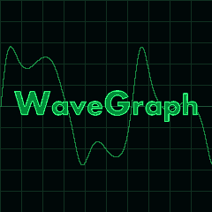

# WaveGraph

[](wavegraph-fm1/)

WaveGraph runs Pure Data-like audio patches on embedded systems. The engine
interprets a compiled signal graph and processes frame-timed events using
caller-owned buffers. Each instrument is a separate crate. The
[instrument guide](instruments/README.md) shows how to implement one as a patch object.

## Crates

| Crate | Description | crates.io | Documentation | Build status |
| --- | --- | --- | --- | --- |
| [`wavegraph`](wavegraph/) | DSP and bytecode interpreter | [crates.io](https://crates.io/crates/wavegraph) | [Patch guide](wavegraph/README.md) | [![Build status][wavegraph-build]][wavegraph-ci] |
| [`wavegraph-303`](instruments/wavegraph-303/) | Monophonic 303 bass synth with accent and slide | Unpublished | [Instrument guide](instruments/wavegraph-303/README.md) | [![Build status][303-build]][303-ci] |
| [`wavegraph-core`](wavegraph-core/) | Patch objects, events and bytecode instructions | Unpublished | [Object interface](wavegraph-core/README.md) | [![Build status][wavegraph-build]][wavegraph-ci] |
| [`wavegraph-fm1`](wavegraph-fm1/) | Three instruments and live oscilloscope for the M-VAVE FM-1 | Firmware | [Controls and build](wavegraph-fm1/README.md) | [![Build status][fm1-build]][fm1-ci] |
| [`wavegraph-monosynth`](instruments/wavegraph-monosynth/) | Sine, triangle, sawtooth and square monosynth | Unpublished | [Instrument guide](instruments/wavegraph-monosynth/README.md) | [![Build status][wavegraph-build]][wavegraph-ci] |
| [`wavegraph-organ`](instruments/wavegraph-organ/) | Four-voice, modeled M1-inspired house organ | Unpublished | [Instrument guide](instruments/wavegraph-organ/README.md) | [![Build status][organ-build]][organ-ci] |
| [`wavegraph-sample`](wavegraph-sample/) | PCM sample types, conversions and arithmetic | [crates.io](https://crates.io/crates/wavegraph-sample) | [Sample guide](wavegraph-sample/README.md) | [![Build status][sample-build]][sample-ci] |

The libraries support Rust 1.88 and build without `std` or a heap allocator.
To browse their API documentation locally, run `cargo doc --workspace --no-deps --open`.

## Patch example

The [engine example](wavegraph/README.md#rendering-a-compiled-patch) runs the
monosynth from bytecode at the FM-1 sample rate.

The [patch integration test](wavegraph/tests/patch.rs) connects two gain objects.
One cord carries audio samples and another carries gain changes. Both objects
apply each change at the same frame. The test renders the patch with `f32`
and signed 24-bit PCM.

```sh
cargo +stable test -p wavegraph --test patch --locked
```

[wavegraph-build]: https://github.com/fm1-rust/wavegraph/actions/workflows/wavegraph.yml/badge.svg?branch=main&event=push
[wavegraph-ci]: https://github.com/fm1-rust/wavegraph/actions/workflows/wavegraph.yml
[303-build]: https://github.com/fm1-rust/wavegraph/actions/workflows/wavegraph-303.yml/badge.svg?branch=main&event=push
[303-ci]: https://github.com/fm1-rust/wavegraph/actions/workflows/wavegraph-303.yml
[fm1-build]: https://github.com/fm1-rust/wavegraph/actions/workflows/wavegraph-fm1.yml/badge.svg?branch=main&event=push
[fm1-ci]: https://github.com/fm1-rust/wavegraph/actions/workflows/wavegraph-fm1.yml
[organ-build]: https://github.com/fm1-rust/wavegraph/actions/workflows/wavegraph-organ.yml/badge.svg?branch=main&event=push
[organ-ci]: https://github.com/fm1-rust/wavegraph/actions/workflows/wavegraph-organ.yml
[sample-build]: https://github.com/fm1-rust/wavegraph/actions/workflows/wavegraph-sample.yml/badge.svg?branch=main&event=push
[sample-ci]: https://github.com/fm1-rust/wavegraph/actions/workflows/wavegraph-sample.yml
