# WaveGraph for the FM-1

WaveGraph gives the M-VAVE FM-1 four assignable mixer channels. It opens on
the first [TB-303](../instruments/wavegraph-303/). Press PLAY to start this
four-bar acid-house arrangement at 122 BPM. Hold **HOME** for a guide to the
current controls.

Why does **ALGORITHM** change presets? Think of the panel from left to right.
Start with the whole rack. **PRESETS** chooses which of the four channels you
play. One turn shows the instruments assigned to all four. Once
you’re on a 303, **ALGORITHM** chooses that 303’s sound, from Deep House to
Pump Panel. For a finer edit, turn **SELECT** to a dial and **ALGORITHM** to
change its value. The four numbered knobs on the right go straight to the
instrument controls. Hold **GLO** and those same knobs become the four channel
faders. Let go and you’re back at the dial you were editing.

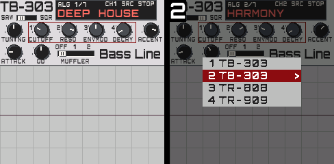

| Channel / USB MIDI | Instrument | Factory part |
| --- | --- | --- |
| 1 | TB-303 · saw | The original sliding bassline, with cutoff, resonance and drive automation. |
| 2 | TB-303 · square | A higher answer drawn from the former M1 chords. Held-gate slides connect C to F and B to E. |
| 3 | [TR-808](../instruments/wavegraph-808/) | Syncopated bass drum, ghost snares and hat pickups between the 909 hits. |
| 4 | [TR-909](../instruments/wavegraph-909/) | Four-on-the-floor kick, backbeat snare and clap, and offbeat closed hats. |

All four patterns start enabled. To change a channel’s instrument, hold **EDIT**
on its instrument screen or in either GLO mixer view. Each channel can host
any instrument, including the [monosynth](../instruments/wavegraph-monosynth/),
[M1-inspired organ](../instruments/wavegraph-organ/),
[Hoover](../instruments/wavegraph-hoover/),
[two-operator FM synth](../instruments/wavegraph-fm/),
[Super Saw](../instruments/wavegraph-supersaw/),
[wavetable synth](../instruments/wavegraph-wavetable/) and
[chromatic sampler](#chromatic-sampler).
The transport starts stopped. You can play the panel keys immediately.
The standard image provides USB MIDI and stereo recording on the black FM-1
with WL82 chip ID `0x00006f01`. Select
**WaveGraph FM-1** in your DAW and enable **Track** in Ableton Live. MIDI
channels 1–4 play mixer strips 1–4. Run `fm1 log` for a round trip over both
MIDI endpoints. See [USB MIDI errata](#usb-midi-errata) for hardware coverage.

To record in Live, select **WaveGraph FM-1** as the audio input device at
44.1 kHz, enable stereo input **1/2**, then arm an audio track with that input.
The FM-1 sends 16-bit stereo PCM after the mixer and master effects. The
physical MASTER knob controls local listening volume independently of the
recording level. The Pump Panel echo alternates between left and right.
USB audio runs from the FM-1 to the computer. If the host falls behind, the
capture FIFO drops excess frames and local playback continues.

| Monosynth | 303 preset | 303 editing Muffler |
| --- | --- | --- |
|  |  | 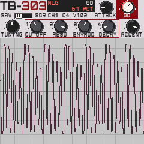 |

## Swap the instrument on one channel

1. On the instrument’s main screen or in either GLO mixer view, turn **PRESETS**
   to the destination channel. Hold **EDIT** for **0.6 seconds**, then release.
   EDIT blinks. The instrument screen shows a green frame and the channel number.
   In GLO, the header changes to **CH 1 / ASSIGN** (or the corresponding channel).
2. Turn **PRESETS** through the alphabetical instrument list. Each click highlights
   a name. After **200 ms** without a turn, the highlighted instrument takes over.
   If you overshoot, turn back before pausing.
3. Play the keys or let the pattern run. The list closes after one second and
   EDIT keeps blinking. Turn PRESETS and pause again to try another instrument.
   The destination stays fixed and the other channels keep playing.
4. **Tap EDIT** to keep the displayed choice and return to the same instrument
   screen, mixer overview or strip editor. Tapping during the 200 ms pause
   takes the choice immediately. PRESETS now moves between channels again.

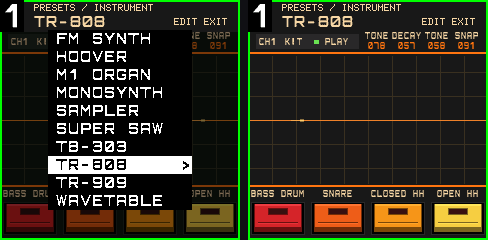

A short **EDIT** press from the ordinary instrument screen opens voice mode on
FM, Hoover, M1 Organ, Super Saw and Wavetable, or sample-region editing on Sampler.

## Panel conventions for new pages

A **channel** is one of the four playable strips. An **instrument** is the engine
assigned to that strip, such as TB-303. A **sound** is a program within that
engine, such as Deep House or Pump Panel. Use these names in control hints so a
player can tell what will change before turning a knob.

| Control | What a new page should do |
| --- | --- |
| **PRESETS** | Move keyboard and edit focus between channels. Keep the current page when the destination supports it. In channel FX, keep the selected slot. On a 303, show the destination’s sound before the player selects a dial. A focus change alone keeps each channel’s sound, mix and running pattern. |
| **SELECT** | Move within the page, for example to another 303 dial, insert slot, parameter bank or Beat FX. Show which item owns the knobs. On an instrument with a fixed set of controls, label its local performance role, such as transpose. |
| **ALGORITHM** | Change the selected item. With no finer selection on an instrument, this can recall a sound, choose a waveform or load a clip. On a selected 303 dial it changes that value. On a selected insert it changes that slot’s effect. Label the role with the musical noun the player needs. |
| **Knobs 1–4** | Give direct access to the values on screen. In the mixer overview they always map to channel levels 1–4. On a selected strip, name the strip and its parameters. |
| **FX** | Open Beat FX from an instrument. Another tap changes banks. Name both banks on screen and show which one the next tap opens. SELECT stays within the current bank. Browsing pages should leave the audio alone. |
| **HOME, EDIT and GLO** | A HOME tap backs out and a HOME hold shows the current page’s guide. Keep assignment behind the explicit EDIT hold. GLO taps open the mixer from an instrument, while a held GLO gives temporary access to levels and mutes. Releasing a used hold consumes the tap. |

Show the new channel on the first PRESETS click. The stock FM-1 patch picker
inspired WaveGraph’s instrument-scope overlay. Dim the faceplate, center the four
channel rows and use the focused instrument’s colors for the selected row. The
list and large channel number share one timeout. On an editor or mixer page, update
its own channel label or strip highlight. Keep shared artwork in place while
the destination’s controls and waveform change.

For example, turn **PRESETS** to channel 2. With its 303 faceplate open,
**ALGORITHM** recalls Pump Panel. Turn **SELECT** to Cutoff and the same
**ALGORITHM** knob now adjusts Cutoff. On the channel FX page, select slot 2
and turn ALGORITHM to choose its effect. Turning PRESETS takes that editor to
another channel. To replace the 303 itself, hold EDIT. The blinking assignment
mode pins the destination and gives PRESETS the instrument list until exit.

When adding a page, update its HOME guide and check the whole gesture during
playback. A musician should be able to hold a note, mix another strip and return
to the same control. Put mix-wide edits on a visibly global page.

## Controls

| Control | Action |
| --- | --- |
| PLAY/STOP | Start all enabled patterns on beat one from any page (green). Press again to release sequenced notes, silence the kit and stop (red). Live held keys keep sounding. |
| LFO | Open the focused channel’s modulation page. LFO or HOME returns to the instrument. |
| SEL in LFO | Enable or bypass modulation. Each instrument starts bypassed with a 5 Hz sine at 25% depth. |
| KNOBS 1–4 in LFO | Set waveform, rate, depth and destination. Knob 4 lists the controls available on the assigned instrument. |
| SELECT in LFO | Clockwise selects tempo divisions from two bars to a sixteenth. Playback start resets the synced waveform. Counterclockwise selects 0.1–20 Hz. |
| MIDI CC1 | The mod wheel sets the same depth as knob 3 on the addressed channel, from zero to full. SEL remains the bypass switch. |
| ARP on an instrument | Open that channel’s arpeggiator. ARP or HOME returns to the instrument. PRESETS browses channels while the editor is open. |
| SEL in ARP | Enable or bypass the displayed channel’s arpeggiator. Each channel starts bypassed. |
| KNOBS 1–4 in ARP | Set order (up, down, up/down, as played, random), rate (1/4 through 1/32, including triplets), octave range (1–4), and gate (1–100%). |
| SELECT in ARP | Turn clockwise to latch the chord. Release all keys and play a new chord to replace it. Turn counterclockwise to release unheld keys. |
| SEQ | Open the current instrument’s pattern bank. SEQ or HOME returns to its instrument. |
| Piano keys in the SEQ pattern view | The first eight white keys (F through the next F) select slots 1–8. The active slot flashes. |
| REC | In SAMPLE mode, REC outside the clipboard records notes into the current sequence. With TAPE LOOP selected, REC arms or punches out an audio pass from an instrument or FX page. On SEQ, REC ends an active tape pass first, then records notes. |
| Hold EDIT on an instrument scope or in either GLO mixer view | [Swap the instrument on this channel](#swap-the-instrument-on-one-channel). While EDIT blinks, turn PRESETS and pause for 200 ms to audition. Tap EDIT to keep the displayed choice and exit. |
| EDIT on an FM, Hoover, organ, Super Saw or wavetable scope | Open the voice mode page. Turn SELECT to choose Poly, Chord or Unison. In Chord, turn ALGORITHM to choose the displayed chord. SEL advances one mode and knob 1 also edits the chord. EDIT or HOME returns to the scope. |
| EDIT in SEQ | Open or close the step editor. KNOB 1 moves the cursor and KNOB 2 selects a bar. Play a key to write at the cursor. |
| SEL held in the step editor | Tap a key to erase, or press EDIT to restore the factory step. |
| PRESETS in SEQ | Browse channels 1–4 while staying in the sequence view. |
| KNOB 2 in the pattern bank | Browse the bars of the selected clip while stopped. While playing, the view follows the audio playhead. |
| SEL in the pattern bank | Mute/unmute the displayed pattern. The other patterns and master clock continue. |
| SELECT in the pattern bank | Turn clockwise for the tempo page, then use KNOB 3 for 30–300 BPM in 1 BPM steps. Turn SELECT back or press the lit HOME button to return to the pattern. |
| PRESETS encoder | Each detent moves to the next channel immediately. On the instrument screen, the selected row and large channel number show the destination. Both clear together 750 ms after the last detent. New notes go to that channel. Held keys keep theirs. |
| Piano keys in ordinary play | At the default octave, the TB-303 plays F2 to G4 and the other chromatic instruments play F3 to G5. The first four white keys trigger drums on the 808 and the first six on the 909. Each pressed key lights up. |
| OCT− / OCT+ | Lower or raise the piano roll by one octave, up to three either way. The setting follows you across presets and pages. Held keys keep their pitch. The button for the active direction blinks slowly at one octave, blinks faster at two and stays lit at three. |
| ALGORITHM encoder | Change mono waveform, switch organ House/Analog harmonic recipes, load a 303 sound preset with channel inserts and Beat FX settings, select a wavetable bank, load the next FM or Hoover program, or choose a sampler clip. While a 303 dial or waveform switch is selected, ALGORITHM adjusts that control. |
| SELECT encoder on the scope | Transpose the monosynth, FM, Hoover, organ, Super Saw, wavetable or sampler by ±12 semitones, or cycle through the eight 303 knobs and its SAW/SQR switch. |
| Knob 1 on the monosynth scope | Sweep the low-pass cutoff from 10 Hz to 20 kHz. Six detents span an octave. The header shows the cutoff in Hz. |
| Knobs 1–4 on the organ scope | Tone, key percussion, transient decay (5–500 ms), release (0–1000 ms). The charcoal panel shows the last-touched value. |
| Knobs 1–4 on the FM synth | Modulator-to-carrier frequency ratio, modulation index, modulator envelope decay (0–10 s), and modulator feedback. Harder strikes sound brighter. |
| Knobs 1–4 on the wavetable | Set START, END, one-way TIME and scan MODE. In ENV mode knob 3 sets position attack. |
| Knobs 1–4 on the Super Saw | Set low-pass cutoff (10 Hz–20 kHz), resonance, detune and side-saw mix. |
| EDIT on the sampler | Open or close the sample region and keyboard tracking controls. |
| ENV | Open or close the focused instrument’s envelope or drum shaping page. ENV stays lit while the page is open. |
| Knobs 1–4 in monosynth, FM, organ, Super Saw, wavetable or sampler ENV | Adjust attack, decay, sustain and release. Turn SELECT or press SEL to choose the envelope on FM (carrier, modulator, pitch), Super Saw or sampler (amp, filter), or wavetable (amp, position). |
| Knobs 1–4 on the 303 | Adjust Cutoff, Resonance, Env Mod and Decay, including while ALGORITHM edits another knob. |
| HOME while editing a 303 control | Clear the selection and turn off the HOME lamp. ALGORITHM browses sound presets again. |
| MASTER | Set the volume of the stereo mix (independent of the mixer faders). |
| Tap GLO | Open or close the four-channel mixer. From either FX bank, it opens the master FX rack. |
| Hold GLO on a scope or supported editor | Open the [momentary mixer](#momentary-mixer). Knobs 1–4 set channel levels. The first four white keys toggle the corresponding strips. Release GLO to return. |
| HOME | Tap to go back one level. Hold for 0.6 seconds to see the controls for the current page. Release to dismiss the guide and stay on the same page. |
| Tap EDIT in GLO | Open [PCM CLIPBOARD](#sample-a-chord-into-the-clipboard). Knob 3 selects SAMPLE or [TAPE LOOP](#layer-a-live-tape-loop). REC arms capture. |
| SEL in the GLO overview or channel edit | Toggle the focused channel’s audio. Each strip shows ON or OFF. SEL lights when the focused channel is enabled. |
| Knobs 1–4 in the GLO overview | Set channel faders 1–4 independently. |
| SELECT in mixer | Open channel edit and move between the four strips. The selected strip is highlighted. |
| Knobs 1–3 in channel edit | Set the fader, reverb send and delay send on the highlighted channel. |
| PRESETS in GLO overview or channel edit | Move keyboard and mixer focus to another strip. Hold EDIT to assign an instrument to the focused strip. |
| HOME in channel edit | Return to the mixer overview. Press HOME again to return to the instrument. |
| FX on an instrument | Open Beat FX on the focused channel. Tap FX again for Channel FX. Subsequent FX taps alternate between the two named banks. |
| Channel FX | Edit the channel’s two insert slots and sends. Turn SELECT to pick a slot and ALGORITHM to choose its effect. PRESETS switches channel and keeps the slot selected. For 3-BAND EQ, knobs 1–3 adjust low, mid and high by ±12 dB. Press SEL to bypass the selected effect. HOME returns to the sends, where knobs 2 and 3 set reverb and delay. |
| Knobs 1–4 with CHORUS selected | Set rate, depth, wet-path tone and wet/dry mix. Both taps fold into the mono strip. |
| Beat FX | Turn SELECT for Echo, Flanger, Slicer or PCF. Turn PRESETS for the channel. Knob 1 sets the beat division shared by the four effects. |
| EDIT within the FX banks | Also switches banks. From the master rack it opens Beat FX. |
| Knobs 1–4 with FLANGER selected in a channel insert slot | Set LFO rate, sweep depth, feedback and wet/dry mix. Full feedback sends 75% of the delayed signal back into the line. At 50% mix the dry signal and moving delay tap have equal weight. |
| GLO then FX, or FX then GLO | Open the global rack. SELECT highlights a device. HOME clears the highlight, then returns to the page that opened the rack. |
| FX or GLO in the global rack | FX returns to the mixer, keeping the selected strip if you entered from channel edit. GLO returns to the FX bank that opened the rack, or Beat FX if you entered from the mixer. |
| SEL in a global device or 303 insert | Toggle that device. The SEL lamp shows its enabled state. |
| ALGORITHM on the master FX overview | Turn left for half output (−6 dB) or right for full output (0 dB). If a device is selected, tap HOME first. |
| SEL button (instrument view) | Switch the scope between the selected voice (VCA for mono, ORG for organ, SRC for FM and 303, OSC for Super Saw and wavetable, KIT for either drum machine) and the post-MASTER DAC mix. |
| Both OCTAVE buttons | Press together to return the piano roll to its default octave. Hold both for two seconds to enter USB download mode. |

For **HOOVER**, turn PRESETS to the destination channel on the instrument screen. Hold EDIT until it blinks, turn PRESETS to **HOOVER**, then tap EDIT to play. Use the four knobs for cutoff, pitch sweep, PWM depth and chorus rate. Press ENV to see the shared pitch/filter/amp contour. Turn SELECT or press SEL to cycle through times T1–T4, levels L1–L3 plus resonance, DCO pulse/saw/sub waveforms plus sub level, and filter/PWM/noise settings. Dominator opens with a low wind-up and sweeps about five semitones above the played note. Hold the key to hear it settle onto pitch, or lift early to catch the rev on its way up. On the scope, **ALG PATCH** shows the sound chosen with ALGORITHM. Its bank runs from Dominator to Fast Hoover, What The and Twin Peak. To replay a Hoover chord or phrase at another pitch, [sample it into the clipboard](#sample-a-chord-into-the-clipboard).

For a stereo audition from the factory rack, assign HOOVER to channel 3 or 4. These strips start with empty insert slots. The Hoover's built-in chorus reaches the headphones and USB capture in stereo on a clean strip. The channel fader and master controls act on both returns. A serial channel insert, Beat Flanger, Slicer or Pattern Filter takes the mono sum while it processes the Hoover. The sampler clipboard, tape and reverb/delay sends also take the mono sum.

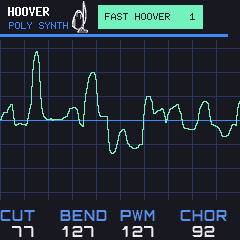

To play FM, choose a channel with PRESETS on the instrument screen. Hold EDIT,
turn PRESETS to **FM SYNTH**, then tap EDIT. Turn ALGORITHM at **ALG PATCH** to recall **Tine EP**, **Glass Bell** or
**Wire Bass**, including its knob values and three envelopes. The
scope's two numbered boxes show operator 2 feeding operator 1. In SEQ the FM
starts with the organ's eight chord clips and has its own edits and slot selection.

Press **ENV**, then turn SELECT or press SEL to cycle through **OP1 CARRIER**
(volume), **OP2 MOD** (brightness), and **PITCH**. Knobs 1–4 set attack, decay,
sustain and release for the displayed envelope. On PITCH, ALGORITHM sets depth
in 10-cent steps from −1200 to +1200 cents. The center line is the played pitch.
Each key starts its own three envelopes. Both operators follow its pitch bend.

| Tine EP playing a chord | Pitch envelope |
| --- | --- |
| 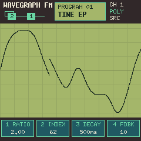 | 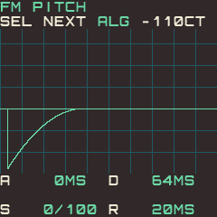 |

## 303 sounds and waveform switch

With no 303 control selected, turn **ALGORITHM** to recall a sound. The readout
shows its number and name. Each channel remembers its own position in the bank;
channel 1 boots on **1 DEEP HOUSE** and channel 2 on **2 HARMONY**. These retain
the previous factory voice settings and saw/square waveforms, with OD now using
the new pedal stage. Both run their
existing saturator in slot 1 followed by sidechain compression in slot 2,
keyed from **909 KICK**, at 75% depth below 180 Hz.

| Preset | Oscillator and voice | Channel inserts, in order |
| --- | --- | --- |
| 1 · DEEP HOUSE | Track 1 voice: saw, 315 Hz cutoff, 82% resonance, 50% OD. | Saturator → Sidechain |
| 2 · HARMONY | Track 2 voice: square, 707 Hz cutoff, shorter decay, 44% OD. | Saturator → Sidechain |
| 3 · PUMP PANEL | Square, 500 Hz cutoff, 86% resonance, 450 ms decay, 67% OD. Centered bass, stereo echo and plate. | Both slots free |
| 4 · REBIRTH BITE | Saw, 397 Hz cutoff, 78% resonance, 400 ms decay, 28% OD. | Saturator → Sidechain |
| 5 · RUBBER SQR | Square, 250 Hz cutoff, 48% resonance, 260 ms decay, 8% OD. | Gentle saturator → Sidechain |
| 6 · ACID PLUCK | Square, 86% resonance, 140 ms decay, 0.75 ms attack, 17% OD. | Saturator → Phaser |
| 7 · DEVIL DRIVE | Saw, 76% resonance, 420 ms decay, 78% OD. | Soft saturator → Sidechain |

Recall replaces the eight voice knob values, waveform, Muffler setting, both insert types,
settings and bypass states, and the channel's Echo send, Echo grid and Slicer.
It keeps the held note, slide switch, sequence, tempo, fader, LFO
and arpeggiator settings. The shared BEATS division, Echo return, global Echo
input and Beat Flanger routing are not changed. Live knob and FX edits remain
until another recall; returning to the same preset restores its factory sound.

Deep House and Harmony keep their factory Echo sends (104/128 and 112/128).
ReBirth Bite and Rubber Sqr use lighter
continuous Echo sends. Acid Pluck echoes only the first sixteenth of each
beat at 100/128 send. Devil Drive uses downbeat echoes and a 56/128-depth
Slicer, with two short cuts in each 16-cell cycle. The Slicer follows the
existing BEATS division (3/4 by default); turn it to 4 for a one-bar gate,
noting that this changes the shared Echo and Flanger timing as well.
To change these grids, press FX from the instrument and select Echo or Slicer. Echo masks apply during transport
playback; live notes use the full send. No preset forcibly opens the shared
Echo input, enables its return, or commandeers the assignable Flanger.
The bank cursor survives GLO instrument changes, alongside the channel's FX.

These are original starting points informed by [AudioRealism Bass Line 3][audio-realism]
for Reason and the ReBirth/modified-303 range in [Transisthor Bass & Rhythm][transisthor].
They do not import those products' preset files. For **PUMP PANEL**, the reference
is *Confusion (Pump Panel Reconstruction Mix)*: [Tim Taylor describes a 303
through an unidentified guitar pedal][pump-panel]. This patch uses the pedal
after the VCA, before channel saturation and sidechain compression. The knob
values are an approximation, not recovered studio settings.

Select **OD**, then turn **ALGORITHM** to set the amount from 0–100%. All 303
presets use this post-VCA pedal. Fully left bypasses it after a short smoothing
ramp. The standalone 303 also exposes oscillator-to-filter gain. On the analog
Devil Fish, **Overdrive** feeds the filter up to 66.6 times the stock oscillator
level. **Muffler** clips the VCA output, catching loud or accented notes first.
See Robin Whittle’s [Devil Fish manual][devil-fish], pp. 4 and 6.

To hear the **Muffler**, start on the 303 scope with no control selected.
Turn SELECT two clicks left, then turn ALGORITHM through **OFF**, **1** and **2**.
The ivory slider shows the setting on this channel. Try an accented square
phrase with OD down first. Position 1 rounds the loudest peaks. Position 2
catches more of the note and adds a firmer buzz. Both carry the bass around
the clipper. Raise OD to drive the pedal with that sound. On Pump Panel the
centered bass tap also hears the Muffler. Every factory preset recalls it off.

The voicing is informed by the TB-03's first overdrive type, which Roland identifies
as a high-gain BOSS OD-2 sound. BOSS describes [OD-2 Turbo][od2] as two gain stages
that clip at the supply rails. To fit the FM-1's real-time budget, our compact
model uses a 330 Hz pre-drive high-pass, one smooth clipping stage, a 1.8 kHz
tone low-pass and 110 Hz output coupling. It runs directly inside the 303's
output loop, with smoothed drive and bypass and no separate audio-buffer pass.
These values were calibrated against 303 phrases and the previous voicing;
they are not recovered TB-03 circuit or DSP parameters. Roland's exact TB-03
algorithm is unpublished, and the other two distortion types are not modeled.
Pump Panel's original pedal is unidentified, so a TB-03-inspired voicing alone
does not establish a match to the record.

PUMP PANEL blends the 180 Hz low-passed clean voice back under the pedal.
The pedal alone feeds a dark stereo eighth-note echo (208 ms at 144 BPM,
27% feedback) and a Dattorro plate with 21 ms of pre-delay and a nominal
1.1-second decay. The first echo leans left and the second leans right.
The reinforced lows and each note attack stay centered. Both effects ring
after key release. The echo follows tempo edits even with the transport stopped.
Recall starts this strip's shared Echo and reverb sends at zero. Other
presets retain the reverb send. The mixer can add either shared effect
and both channel insert slots are available for live edits.
Muting the strip in GLO stops it feeding the echo and plate. Existing tails ring out.

Try Pump Panel with accented, sliding notes and sweep cutoff with knob 1.
The existing sequencer automation still owns its recorded parameters during
playback, so a pattern can temporarily override preset cutoff, resonance or
OD. MIDI CC17, clip automation and the OD LFO target all address the same
post-VCA amount.
Play the piano roll or mute that channel's sequence to hear the stored
settings directly; the preset does not replace the sequence with the record's riff.

The first row of dials follows the [Roland TB-03][tb03] order from Tuning
through Cutoff, Resonance, Env Mod, Decay and Accent. The four numbered
encoders map to the lighter knobs inside the red outline. Attack, OD and the
three-position Muffler switch sit on the row below, alongside the **Bass Line**
wordmark. The live scope uses the lower 240 × 144 pixels.

From idle, turn SELECT clockwise to reach Attack, OD, Muffler, the **SAW/SQR**
slide switch and then the six original dials. One click counterclockwise
selects waveform. Turn ALGORITHM left for saw or right for square.

The control highlighted in oxide red is the ALGORITHM target. Selecting a
dial lights HOME and shows **ALG SET / HOME** below **Bass Line**.
ALGORITHM adjusts that control, and the display beside the logo shows its value
even while you turn a numbered encoder. Press HOME to finish and see the preset
number and name again. Tuning covers
±12 semitones in 10-cent steps, Attack spans 0–60 ms, Accent spans 0–100% and
OD covers 0–100%.

Each cap and the waveform actuator point to their saved settings. During pattern
playback a separate red mark on each automated control follows the sequencer.
The marks disappear when you play the 303 live, mute its pattern or stop playback.
The scope opens on the selected 303’s pre-fader signal (SRC). Each sweep starts
at an oscillator phase wrap and shows 27.2 ms of filtered audio, about two
cycles of the factory bass line’s low D. The fixed time scale lets you see the
cycles draw closer together on an upward slide. Automatic
sensitivity fits each sweep to the display and stops boosting below −36 dBFS
so tails fade to a flat line. Press SEL to see the master mix (DAC) at its
fixed scale.

Hold a bass note on channel one, turn PRESETS to channel two, and play the
upper voice. Each key keeps the channel it was pressed on. The 303 and
monosynth use last-note priority. On the 303, velocity 96+ triggers accent,
overlapping notes slide, and a fresh strike after release restarts the
envelopes. On the FM, Hoover, organ, Super Saw and wavetable synths, the latest four physical keys take priority.
Releasing a newer key restores an older held key.

Their scopes show the mode or the selected chord symbol. These instruments start in **Poly**, with one voice per key. **Chord** plays the
selected voicing from a single root. **Unison** spreads all four voices
around one pitch (approximately ±2 and ±7 cents). In either stacked mode the
newest held root wins. Releasing it recalls the previous held root and its
velocity. Changes on the EDIT page apply immediately to held notes, including
notes from MIDI, the sequencer and the arpeggiator.

## Channel modulation

The faceplate, knobs, sequencer and both insert units use the assigned instrument’s colors. The same scope palette follows the signal from the instrument page to the post-insert, pre-fader tap on Channel FX. PRESETS moves between channels throughout channel FX. Turn SELECT to highlight an insert, then ALGORITHM to browse its effect types. Turn PRESETS to compare the same slot on another channel. Tap HOME to return to the sends.

Each channel runs its own control-rate LFO. Depth scales a bipolar sweep around the current knob setting. Changing the destination or bypassing the LFO restores that setting, including edits made during the sweep.

| Instrument | LFO destinations in knob 4 order |
| --- | --- |
| Monosynth | Filter cutoff |
| M1 organ | Tone, percussion, click decay, release |
| TB-303 | Pitch (±2 semitones), cutoff, resonance, env mod, decay, accent, attack, OD |
| TR-808 | Kick tone, kick decay, snare tone, snappy |
| TR-909 | Kick decay, snare decay, clap decay |
| Super Saw | Filter cutoff, resonance, detune, side-saw mix |
| Wavetable | Scan start, scan end, travel time (attack in envelope mode), scan mode |
| FM | Modulation index, feedback, frequency ratio, modulator decay |
| Hoover | Cutoff, pitch sweep, PWM depth, chorus rate |
| Sampler | Filter cutoff, resonance, filter envelope amount, velocity-to-cutoff depth |

On the TR-808, ENV exposes the kick body and transient controls alongside snare tone and wire level. On the TR-909, knobs 1–3 adjust the modeled kick, snare and clap tails from 0–100% of their stock decay times. The factory pattern starts at 55%. Both drum pages show strike and tail activity. The 909 hats and ride play their recorded tails, and closing the hat still chokes the open hat.

## M1-inspired organ

The organ is **modeled, not sampled**. ALGORITHM selects either a 1:3:6
harmonic recipe (House) or a brighter 1:4:8 blend (Analog). Both include
short key percussion with its own decay and a separate per-voice amplitude envelope.
The modeling follows independent community recipes, not Korg's actual PCM
multisample. No Korg ROM data is bundled. For a proper similarity check,
compare a dry Organ 2 patch in the Korg M1 plug-in against both modes; a
spectrum and envelope comparison would be more informative than a single
house-music recording.

The organ's dark charcoal panel with lime accents and a cyan readout takes
visual inspiration from the [KORG Collection M1 V2 UI][korg-m1]. Turn PRESETS
to play another channel. The four-channel list appears over the dimmed
waveform. An arrow and the destination instrument’s highlight color mark the
selected row.

## Super Saw

On the instrument screen, turn **PRESETS** to the destination channel. Hold
**EDIT**, turn **PRESETS** to **SUPER SAW**, then tap **EDIT** to play it.
The strip keeps its MIDI channel, level and sends. Each assigned instance has
four independently gated voices and its own panel settings. Each note has seven
oscillators, a pitch-tracking high-pass, a resonant low-pass and both envelopes.
A seventh chord or Unison uses all 28 oscillators on that strip.

On the blue JP-8080-style panel, knob 1 (**CUTOFF**) sweeps the low-pass in
six detents per octave. Knob 2 (**RESO**) emphasizes frequencies around the
cutoff. Knob 3 (**DETUNE**) spreads the six side saws, and knob 4 (**MIX**)
sets their level around the center saw. The 240 × 168 scope opens
on the filtered voice (**OSC**). Press **SEL** to see the
post-MASTER mix (**DAC**). The small display shows the channel and the held
key, or the pattern status during playback. The four-bar pattern leaves space
between sustained upper notes so the beating is audible.

Press **ENV** for the matching blue envelope editor. Turn **SELECT** or press
**SEL** to switch the amber tab between **AMP** and **FILTER**. The four knobs
edit attack, decay, sustain and release for the highlighted envelope. Each
strip remembers both contours. To hear the filter envelope, hold a low note,
lower the base cutoff to about 500 Hz, raise resonance, then lengthen FILTER
attack. Lengthening AMP release also lets you hear the filter close after key-up.

| Super Saw panel | Filter envelope |
| --- | --- |
|  |  |

## Wavetable

On the instrument screen, choose the channel with **PRESETS**. Hold **EDIT**,
turn **PRESETS** to **WAVETABLE**, then tap **EDIT**.
**ALGORITHM** switches between two 64-frame programs. Each remembers its
scan settings and position envelope for as long as the instrument occupies the strip.

| Program | Try it |
| --- | --- |
| Resonant Saw | Hold a low note and turn knob 1 (**START**) to step through the resonances. Turn knob 4 (**MODE**) one click to SMOOTH for intermediate timbres. |
| Vocal Formants | Roll a chord and let it ring. Each key starts its own sweep. Turn knob 3 (**TIME**) to slow the vowels down and knob 2 (**END**) to narrow the range. |

START and END run from 0 to 127. TIME covers 50 ms to 8 s per traversal.
ONCE holds the end frame and PINGPONG returns through the same frames.
The red dial and FRAME readout show the newest sounding voice's position
(0–63). The 240 × 168 scope shows its channel's complete polyphonic output,
with automatic gain. **SEL** switches to the master mix at fixed gain.
**PLAY** brings in a four-bar chord part with space for each voicing to evolve.

For a vowel that opens on each keystroke, select **Vocal Formants** and turn
knob 4 one click clockwise from **PINGPONG** to **ENV**. Knob 3 now sets
**ATTACK**. Hold a chord and turn it up to hear each note take longer to
reach END. Press **ENV**, then turn **SELECT** or press **SEL** to switch
between the strip's **AMP** envelope and the program's **POSITION** envelope.
Knobs 1–4 edit attack, decay, sustain and release on the displayed curve.
At 50% position sustain, each held key settles halfway between START and END.
Lengthen AMP release to hear the sweep return to START after key-up.

The blue face, red encoder and green readout draw on the original
[Waldorf Microwave panel][microwave]. The [instrument guide][wavetable]
covers the scan engine and the sources of both banks.

| Vocal Formants on the scope | Wavetable position envelope |
| --- | --- |
| 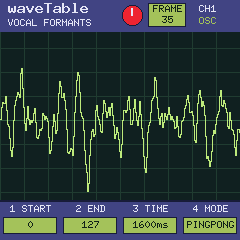 |  |

[microwave]: https://waldorfmusic.com/microwave-1/
[wavetable]: ../instruments/wavegraph-wavetable/

## VCA envelope

Hold a key and turn Knob 3 to hear the sustain level change. Release the key
and turn Knob 4 to shorten or extend the tail. The graph and readouts also
respond while the keyboard is idle. Press ENV again to return to the scope.
PRESETS moves to the next channel’s ENV page. The channel label stays visible
so you can tell two copies of the same instrument apart. Each channel recalls
its own settings.

| Knob | Parameter | Monosynth range (initial) | Organ range (initial) |
| --- | --- | --- | --- |
| 1 | Attack | 1.5 ms–4 s (8 ms) | 0–4 s (4 ms) |
| 2 | Decay | 2 ms–10 s (160 ms) | 0–10 s (180 ms) |
| 3 | Sustain | 0–100% (70%) | 0–100% (68%) |
| 4 | Release | 2 ms–10 s (125 ms) | 0–1 s (180 ms) |

On the organ, knob 4 edits the same release in either view, in 5 ms steps.
Knob 3 on the scope sets the key click's decay. On the ENV page, lower sustain
to hear knob 2 shape the decay of the whole note.

The monosynth ranges follow the [Roland SH-101][sh101]. The editor scales each
stage's width by knob position so you can see a short attack next to a long
release. The flat section shows the level held until key-up.


## 303 envelope preview

Press ENV on the silver 303 page. The display plays a silent reference phrase
through a separate instance of the voice’s envelopes. PLAIN marks one ordinary
strike. The three A marks are accented strikes 96 ms apart. Each vertical grid
division is 96 ms. The numbered knobs keep their assignments here. Turn SELECT
to choose a dial, Muffler or waveform switch, then ALGORITHM to edit the
value below the traces. HOME clears the selection so ALGORITHM recalls sounds.
HOME clears the selection. Press it again to return to the scope.

| Trace | What to try |
| --- | --- |
| VCF · filter cutoff (62.5 Hz–16 kHz, logarithmic) | Raise Env Mod to deepen the sweep. Decay stretches the plain strike. Accented strikes keep their short filter decay, about 200 ms to 1% in this model. |
| ACC · accent contribution to cutoff (0–3 octaves) | Select Accent and raise it with ALGORITHM, then raise Resonance with knob 2. The later accents start with charge left by the previous strike. Higher resonance slows the drain. |
| VCA · amplitude gain (0–1.9) | Select Attack and turn ALGORITHM to lengthen it. Accent also boosts the gain. |

To isolate the rounded sweep, turn Env Mod down to zero and raise Accent and
Resonance. On the original 303, some direct filter modulation remains at
minimum Env Mod.

The hardware uses a second section of the resonance pot and a 1 µF capacitor
in its accent sweep. WaveGraph approximates that branch with a 12 ms charge
time constant and an 80–430 ms drain. The preview uses the same equations as
the audio voice. [Robin Whittle’s circuit description][accent-sweep]

| Main envelope and accents | Accent sweep with Env Mod at zero |
| --- | --- |
| 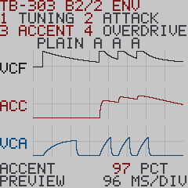 | 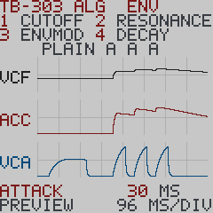 |

## TR-808 instrument view

Turn PRESETS to channel three to play the factory 808. To put another 808
on any channel, choose its strip with PRESETS in GLO. Hold EDIT, turn PRESETS
to **TR-808**, then tap EDIT. The strip keeps its MIDI channel, fader, sends
and sequence mute. Tap GLO to open the instrument.

The four red, orange, amber and yellow switches show the actual voices in that strip. A strike depresses the cap and lights
the lens. The lamp dims through the tail and goes dark when the voice stops.
The scope shows the pre-fader kit, and SEL switches it to the master output.
Knobs 1–4 adjust kick Tone, kick Decay, snare Tone and Snappy. Each dial shows
its current value.

| Switch | Panel key | USB MIDI note |
| --- | --- | ---: |
| Bass drum | F3 | 36 |
| Snare | G3 | 38 |
| Closed hi-hat | A3 | 42 |
| Open hi-hat | B3 | 46 |

The factory 808 plays between the 909's hits. Short sub kicks answer the main
kick, ghost snares punctuate the bar turns, and open hats lead into the next
phrase. A closed hat chokes its ringing open partner. MIDI strike velocity
sets each voice's excitation.


## TR-909 instrument view

Select a TR-909 channel with PRESETS to see its pre-fader kit waveform. SEL
switches the trace to the final DAC mix. The orange pulse follows the transport.
The six key lamps follow this kit in either scope mode. Each lamp flashes at
the attack and glows dimly through the tail. A closed hat cuts off an open hat
immediately.

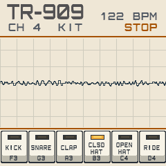

Press PLAY to watch the pattern, or trigger the lamps and voices from the
panel or USB MIDI with the transport stopped. The six physical pads keep their
assignments across octave changes. SEQ opens the drum pattern and HOME returns
to the same live view.

| Voice | Panel key | USB MIDI note |
| --- | --- | --- |
| Kick | F3 | 35, 36 |
| Snare | G3 | 38, 40 |
| Clap | A3 | 39 |
| Closed hat | B3 | 42, 44 |
| Open hat | C4 | 46 |
| Ride | D4 | 51 |

## Chromatic sampler

On the instrument screen, choose a channel with **PRESETS**. Hold **EDIT**,
turn **PRESETS** to **SAMPLER**, then tap **EDIT** to play. A new strip starts on **AMEN BRK**.
Turn **ALGORITHM** one click for **MIN7 STAB**, then **RAVE RISE**, **AIRHORN**,
**LASER ZAP**, **RAVE STAB** and the shared **CLIPBOARD**. Each strip plays four independent,
velocity-sensitive sampler voices from the panel, MIDI or sequencer. The
LCD shows the original-speed **ROOT** key. The break and effects use C4
(MIDI 60), MIN7 STAB uses D4 (62), and RAVE STAB uses G2 (43). An octave up
doubles the pitch and halves the duration.

**MIN7 STAB** prints FM electric-piano tines, detuned reeds, a lower D and two
short echoes into one sample. Play D4 for D–F–A–C. Hold D4 and add A4 to
layer in E and G for Dm11. D3 and A3 double those two chords down an octave
using all four voices. Its factory sequence stays in the rack’s D minor key.
Pattern 01 leaves room for the 303 attacks and layers a fifth on the turnaround.

Kevin Saunderson describes sampling a chord, playing another chord from it
and layering the result. The source was the closing minor triad on Nitro
Deluxe’s “Let’s Get Brutal.” WaveGraph’s minor seventh is an original recording.
[Saunderson's interview](https://www.beatportal.com/articles/201936-producer-spotlight-kevin-saunderson) ·
[“Big Fun” production credits](https://djmag.com/longreads/kevin-saunderson-e-dancer-returns) ·
[Richard Harding’s harmonic analysis, pp. 161–162](https://salford-repository.worktribe.com/preview/2706131/Richard%20Harding%20-%2000560665%20-%20The%20Role%20of%20Harmony%20in%20the%20Construction%20of%20a%20Machine%20Aesthetic%20in%20Electronic%20Dance%20Music.pdf)

On the Emulator II, a voice paired a recording with its tuning, loop points,
four-pole resonant low-pass filter and separate filter and amplitude ADSRs.
Velocity could change the tone as well as the level. Engineer David Jacobs
described using a keyboard-pitched Emulator II kick alongside a DX7 and
Jupiter-6 for the bass on “West End Girls.” Here each strip remembers those
tone and region edits separately for each sample. RAVE STAB has a closing
filter sweep, and soft horn and laser strikes play darker.
[E-mu's 1985 design paper](https://quod.lib.umich.edu/cgi/p/pod/dod-idx/emulator-ii-computer-music-environment.pdf?c=icmc%3Bidno%3Dbbp2372.1985.018%3Bformat%3Dpdf) ·
[Emulator II owner’s manual](https://synthark.org/resource/emu/EmulatorII%2B_OwnersManual.pdf) ·
[1986 studio interview](https://www.muzines.co.uk/articles/track-record-the-pet-shop-boys/11054)

| Page | Knob 1 | Knob 2 | Knob 3 | Knob 4 |
| --- | --- | --- | --- | --- |
| Instrument | Filter cutoff (Hz or OPEN) | Resonance | Filter envelope depth (−48 to +48 semitones) | Velocity to filter (0–48 semitones) |
| ENV | Attack | Decay | Sustain | Release |
| EDIT | SHOT / GATE / LOOP / SLICE (Amen) | Start (%) | End (%) | Filter key tracking (0–100%) |

On **ENV**, turn **SELECT** or press **SEL** to switch between AMP and VCF.
Edits shape all sounding voices of the selected sample. Set a positive or negative **ENV AMT**
on the instrument page to hear the filter contour. At 100% key tracking the
cutoff moves an octave for every octave played. On **EDIT**, SHOT plays the
whole region after a tap, GATE releases on key-up, and LOOP repeats the region
while held. Mode and trim take effect on the next strike. On the instrument
page **SELECT** transposes live keys and **SEL** switches the scope tap.

To replace the 808 with the break, assign **SAMPLER** to its strip and press
**PLAY** with pattern **01**. It triggers C4 at full velocity every four
bars. The break follows tempo changes in place by varying playback speed
and pitch together. The other five recordings keep their keyboard tuning
when the transport changes. Amen starts as a full-length one-shot with unity
amplitude, a bypassed filter and the original relative levels of the drum
hits. The filter and envelopes remain available if you want to reshape it.

All six CC0 sounds stream from upper flash. The default bank plays the four-bar
Amen remake at 12,505 Hz, with eight chops cut for that recording. The house
minor seventh uses 8 kHz, the rave stab 7,353 Hz and the laser zap 14,706 Hz.
Those three hits use 10-, 8- and 12-bit quantization respectively before IMA
ADPCM encoding. The airhorn uses lossless PCM1 at 22,059 Hz and the rising
siren uses its original 14,700 Hz IMA recording. [Sample credits](samples/rave/NOTICE.txt)

### Chop the Amen into SEQ REC

On **AMEN BRK**, press **EDIT** and turn knob **1** clockwise to **SLICE**.
**C4** plays the complete four bars at transport tempo. The other lit white keys,
**F3 G3 A3 B3** and **D4 E4 F4 G4**, play eight cuts in source order. G3 gives
you the first backbeat and G4 the final fill. A new pad cuts off the previous
one, including the full break. Lifting a finger lets the hit finish.

Strike a chop to select it. Knobs **2** and **3** trim its start and end within
that chop. The highlighted part of the waveform follows the edit. Press **REC**
and play the lit keys to record the same pad numbers and velocities into the
current pattern. Octave and strip transpose have no effect on pad assignments.
The SEQ pattern picker keeps its normal eight bank keys.

### Sample a chord into the clipboard

1. From the Hoover instrument screen, press **GLO**, then **EDIT**. If you
   still have the factory rack, first choose a strip with **PRESETS** in **GLO**.
   Hold **EDIT**, turn **PRESETS** to **HOOVER**, and tap **EDIT** to finish.
   Tap **EDIT** again to open the clipboard. Check the source channel and
   instrument on the **PCM CLIPBOARD** page. You can
   turn **PRESETS** here to choose another channel before arming.
2. Knob **1** sets **LENGTH** (one beat or one, two or four bars). Knob **2**
   sets **ROOT**, the key that will replay the take at its original pitch and
   speed. The defaults are **1 BAR** and **C4**. For a short D minor stab,
   choose **1 BEAT** and **D4**.
3. With the transport stopped and the Hoover silent, press **REC**. At
   **PLAY A NOTE**, play your chord (for example, D4–F4–A4). The first sound
   from the strip starts the take. With the transport running, the screen
   shows **WAITING FOR DOWNBEAT** and capture starts on beat one of the next bar.
4. During **RECORDING**, let the selected length elapse or press **REC** to
   finish early. **READY** means the sample is playable. While waiting, you
   can change length and root or press **REC** to cancel. Once recording
   starts, knob changes apply to the next take.

**Play the take from a sampler strip**

- **Sampler already assigned.** Stay on **PCM CLIPBOARD** and turn **PRESETS**
  to the sampler channel. Press **SEL** (**USE CLIPBOARD**), then **HOME**.
- **Need a sampler.** Press **EDIT** to return to the mixer. Choose a
  different strip with **PRESETS**. Hold **EDIT**, turn **PRESETS** to
  **SAMPLER**, then tap **EDIT**. Press **GLO** to open its instrument screen,
  then turn **ALGORITHM** one click counterclockwise from **AMEN BRK** to **CLIPBOARD**.

Play **D4** to hear the example chord as recorded, or **D5** to hear it an
octave higher in half the time. A sampler strip can play four copies at once.

If you see **CHOOSE ANOTHER SOURCE**, the selected sampler is playing the
clipboard itself. Turn **PRESETS** back to the Hoover, then press **REC** to arm.

The recorder takes mono audio from the instrument output, including the
Hoover’s built-in chorus when enabled. The channel inserts, fader and effect
sends come after this point. All sampler strips share one 64 KiB PCM16 take
in RAM and keep their own sample controls. A new recording replaces the old
take when capture starts. Powering off clears it. Longer takes use a lower
sample rate to fit. At the factory 122 BPM, **1 BEAT** keeps the full 44.1 kHz
and **1 BAR** records at 14.7 kHz.

### Layer a live tape loop

1. Press **GLO → EDIT** and turn **knob 3** clockwise to **TAPE LOOP**.
   Turn **PRESETS** to the drum strip and **ALGORITHM** counterclockwise for
   **STRIP**. Choose **1 BAR** with knob **1** and set the sample root with
   knob **2**. Knob **4** controls the incoming recording level.
2. Press **REC**, then **PLAY**. If already playing, REC arms the next loop
   boundary. Play the drums or let their pattern run. The first pass closes
   after the selected length and immediately plays back on its own return.
   Mute the original drum strip in GLO to hear the loop by itself.
3. Choose a 303 strip with **PRESETS**. Press **REC** to arm an overdub,
   open its **Beat FX → PCF** page and audition rhythms or sweep the cutoff.
   The previous pass keeps playing. Each lap adds what you play until you
   press **REC** again to punch out. REC works on the instrument and FX pages
   too. The recording source stays on the strip you armed.
4. **PLAY** stops or restarts the loop with the sequencer. Turn knob **3**
   back to **SAMPLE** to silence the tape return and play the layered take
   chromatically or slice it on a sampler strip. To start a fresh loop,
   stop the transport and hold **SEL** while pressing **REC** on TAPE LOOP.

**STRIP** records the instrument, both inserts, Beat Flanger, PCF and Slicer
before the fader. Turn **ALGORITHM** clockwise for **MIX** to print the live
strip levels, mutes and shared Echo and reverb returns. Both taps exclude
the tape return. The input selection latches when you arm. Lower knob **4**
to leave headroom for more layers. A silent pass preserves the old audio,
and the stored PCM saturates if layers exceed full scale.

Loops use the sequencer grid of one beat or one, two or four bars. A tempo
change speeds up or slows down a finished loop and changes its pitch.
An existing clipboard sample can seed a loop and fits its original selected
beat length, including a sample finished early. **REC** cancels an armed
pass or an unfinished first pass. Keep the tempo steady during that first
pass. Punching out of an overdub keeps the audio printed so far. If the DSP
misses a block, the overdub punches out and playback rejoins at the next
loop boundary. All layers share the original 64 KiB RAM slot and are
combined into one take. Powering off clears it.

If the source is a sampler playing this clipboard, choose another strip.
For MIX, mute that sampler strip before arming the next pass.

## Pattern banks

Press **SEQ**, turn **PRESETS** to the channel you want, and press one of the
eight lit white keys. **F, G, A, B, C, D, E, F** select the numbered slots from left
to right, even after an octave change. The pressed key and its on-screen button
blink off and back on once to acknowledge the press. While stopped,
a selection immediately previews bar one. During playback, the grid and flashing
key follow the sounding clip. An underline and **QUEUED** identify the incoming
slot. Press another key to replace the request or the active key to cancel it.

Each channel starts its new clip at step one on the next bar line. The other
channels continue wherever they are in their phrases. This adapts ReBirth’s
independent pattern selectors to WaveGraph’s multi-bar loops. Each strip
remembers its selection for each instrument until power-off. **SEL** mutes the
displayed channel. **KNOB 2** browses its bars while stopped. Turn **SELECT**
clockwise and use **KNOB 3** to set the master tempo. [ReBirth operation manual,
pp. 19–21][rebirth] · [TB-03 owner's manual][tb03-manual]

| Key | Pattern | Bars | Factory rack |
| --- | --- | ---: | --- |
| F | 1 · Original | 4 | Sliding low 303 and high square answer over the four-on-the-floor 909. The 808 fills the gaps. |
| G | 2 · Undertow | 2 | Low fifth-to-seventh slides answer the high line. Backbeat claps alternate with snares and an open-hat pickup. |
| A | 3 · Jack Track | 1 | Octave bass stabs, a climbing upper voice and an extra 909 kick just before beat four. |
| B | 4 · Negative Space | 2 | An off-downbeat bass leaves room for syncopated hats and a sparser backbeat. |
| C | 5 · Acid Trip – Pulse | 1 | The low 303 jumps octaves under a sparse upper answer. The 808 plays the backbeat against a four-on-the-floor 909. |
| D | 6 · Acid Trip – Full Kit | 1 | The bass slides up from the seventh. Ghost snares, claps and offbeat open hats fill out the groove. |
| E | 7 · Acid Trip – Break | 2 | A chain of 303 slides rides over a kickless bar of sixteenth-note hats. The kick returns under a snare roll in bar two. |
| Higher F | 8 · Devil Fish | 1 | The open-hat steps of the source groove lift the bass into four accented high notes. The second 303 answers above the backbeat. |

Slots 5–8 adapt two demo songs by **verytired** from the MIT-licensed
AfterBirth AB-3389. Both 303 lines are transposed from C to D to sit alongside
the factory bassline. The monosynth, M1 organ, Super Saw and wavetable each
have eight clips, with their own voicings and rhythms. [Pattern sources and kit mappings](patterns/README.md)

The melodic grid shows note lengths. On a 303, **A** marks an accent and **S**
a note entered with slide. Three traces show the cutoff, resonance and drive
messages in the clip. The drum grid puts each voice on its own row with sixteen
steps grouped in fours. The charcoal 808 has four voice lanes and the ivory 909
has six. The lower strip follows the current step. [ReDrum drum computer][redrum]

| TR-808, queued change | TR-909, pattern 8 |
| --- | --- |
| 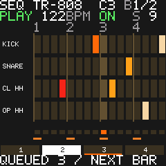 | 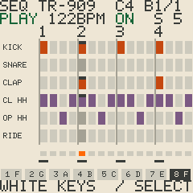 |

Live keys outside the pattern view temporarily take over their melodic channel.
Releasing them rejoins the clip at the next scheduled note. Inside the pattern
view the piano keys operate the bank. USB MIDI still addresses its assigned
instrument. The transport, gates and controller events share the existing
audio-frame clock. Changing tempo retains the position within the step.

### Recording and step editing

Choose a pattern, then press **REC** and play the piano roll. The REC lamp lights
and the transport starts if stopped. Each strike uses the sixteenth currently
sounding on that channel, including its local bar and bank slot during a queued
change. New notes keep the panel velocity and octave or drum-pad mapping. They
repeat with a gate of three quarters of a sixteenth. Press **REC** to finish the
take while the loop continues. Leaving REC or changing channels also disarms it.

Press **EDIT** in SEQ for a stationary cursor. Turn **KNOB 1** for steps 1–16
and **KNOB 2** for the bar, even during playback. Tap a key to audition and
write there. A melodic edit replaces the factory notes at that step. Organ, Super Saw
and wavetable accept up to four pitches per step. On kits, each pad edits its
own voice, so adding a hat preserves the kick and snare. Factory controller
automation continues through edits.

Hold **SEL** and tap a key to write a melodic rest or clear that drum voice.
Hold **SEL** and press **EDIT** to restore the entire factory step. Edits survive
transport stops, slot changes and instrument swaps during the session. The
shared RAM pool holds 16 edited bars. Restoring every edited step in a bar
frees it for reuse. Power cycling restores all factory clips.

## Live arpeggiator

Play a chord on the panel or send notes to USB MIDI channel 1–4. The first
step sounds on the first keypress, then follows the master BPM even with PLAY
stopped. Each step reaches both the assigned instrument and the corresponding
USB MIDI output channel with its strike velocity. The ARP page highlights
the outgoing pitch on a miniature keyboard in the instrument’s colors.

A live or latched chord takes over its own pattern lane. The clip keeps its
place and resumes when the chord is released. The other channels continue to
play. The 808 and 909 pads use their kit MIDI notes, so the arp can repeat a
single drum or alternate hits. Octave transposition can produce pitches the
local kit leaves silent. Reassigning an instrument resets that channel’s arp.

## MIDI files and USB MIDI

Each bank has eight Standard MIDI Files under [patterns/](patterns/).
For example, drag `patterns/tb303-low/01.mid` into a DAW to hear or edit the
original bassline. For import, save a clip over `01.mid` through `08.mid` in
the desired bank, then [build and flash](#build-and-flash). MIDI files are the
source for both playback and the display. The build compiles the events, pitches,
and clip directory into the upper-flash asset file.

Export one instrument channel in SMF format 0 or 1, with PPQN timing and one to
four bars of 4/4. End-of-track determines the length, rounded up to a bar.
The compiler rounds events to 32 ticks per quarter and accepts notes and CCs.
End each note, allow at least one tick for each gate, and keep chords to four
notes. Each tick can carry up to sixteen messages, including up to six drum
strikes for a kit. The master transport supplies the playback tempo.

When the BSP enables USB MIDI, channels 1–4 address mixer channels 1–4.
Playing patterns send their notes and CCs on those channels, so a DAW can
record a performance or route it to a TB-03 or plug-in. Incoming notes and CCs
use the same MIDI message type as the clips. Disconnecting the host releases its
held keys. The piano roll tracks panel and USB notes separately when they overlap.

| 303 parameter | MIDI |
| --- | --- |
| Filter cutoff / resonance | CC 74 / 71 |
| Envelope modulation / decay | CC 12 / 75 |
| Accent level / OD / tuning | CC 16 / 17 / 104 |
| Accented note | Note-on velocity 100–127 |
| Slide | CC 102 on at 64–127. Factory slides also overlap notes for legato synths. |
| WaveGraph attack / waveform | CC 73 / 70. Waveform values 0–63 select saw and 64–127 select square. |

The factory sweeps follow the original cutoff, resonance and drive contours at
seven-bit MIDI resolution. The sequencer owns each voice control it automates
until the clip gives it back to the retained knob or USB setting. Other CCs
pass through to the host, including TB-03 delay time and feedback on CC 18
and 19. The FM-1’s shared delay is edited in global FX. [Roland TB-03 MIDI
implementation chart][tb03-midi]

[rebirth]: https://www.deepsonic.ch/deep/docs_manuals/propellerhead_rebirth_rb338_v2.01_manual.pdf
[tb03-manual]: https://static.roland.com/assets/media/pdf/TB-03_eng03_W.pdf
[tb03-midi]: https://static.roland.com/assets/media/pdf/TB-03_MIDI_Imple_e01_W.pdf
[redrum]: https://docs.reasonstudios.com/rackplugin12/redrum-drum-computer

## Audio overloads and USB log

A seven-pixel dot in the upper-right corner turns amber on a missed audio
deadline and red on a second miss within one second. It disappears after one
second without a miss. The synth scope’s `V` readout is the current note velocity.

A small red battery outline appears just left of the dot when the panel scanner
confirms a low battery. It stays in that position even when the dot is hidden
and disappears once the scanner confirms recovery.

On a build with USB MIDI active, hold SAVE while running `fm1 log` from the
[FM-1 CLI][cli] for the timing snapshot. The example
`B1 D02400 F00080 W00076 O00000000 S00000002` means CPU1 started successfully
(`B1`), peak DSP render took 2,400 µs, peak refill took 80 µs and peak
successful DMA write took 76 µs. The last two fields count BSP overruns and
silent fallback blocks in hexadecimal. Times round up to microseconds and
saturate at 99,999 µs in the USB reply. The display shows the full range.
After a CPU1 failure, a log request returns the timing snapshot even with SAVE released.
`B0` is a boot timeout, `B2` a context mismatch, `B3` a reply mismatch,
`B4` a fault and `B5` a renderer that stopped returning blocks.

Release SAVE and run `fm1 log` for recent overload events. For example,
`XR12 T4870 W3070 G2902 DMA` reports the 12th miss, 4,870 ms after boot,
with 3,070 µs of interrupt work and 2,902 µs since the previous audio IRQ.
`DMA` means the refill crossed a DMA boundary. The nominal 128-frame budget
is 2,901 µs. Timestamps have 10 ms resolution. Work and gap values saturate
at 99,999 µs. The snapshot holds the latest one or two events that fit the
USB log packet, including misses while disconnected. Repeated reads preserve
the snapshot until another miss occurs.

The graph skips the oscillator and filter work of silent keyboard parts.
Held notes, VCA release tails and both shared effects keep running when you
change presets. The 303 still discharges its accent capacitor while silent.

[cli]: https://github.com/fm1-rust/fm1-rust/tree/main/fm1-cli

### USB MIDI errata

The black FM-1 used for the board tests played a note from Live, answered
`fm1 log` over SysEx, and reappeared in Live after unplugging and reconnecting.
The ID probe reported WL82 chip ID `0x00006f01` and loader tag `fm1`.
WaveGraph targets the FM-1 and selects the composite MIDI and audio driver by the full chip
ID. Other revisions and emulators reporting zero use the BSP's checked
startup. In `fm1` 0.2.1 that leaves USB detached and the instrument playable.
The application keeps these assumptions in [USB startup](src/usb_midi.rs).
The MIDI router, mixer and synths consume safe packet values.
Audio capture additionally assumes EP4 IN reads only its permanent 192-byte
arena and the copy engine completes transfers of up to 184 bytes before
staging is reused, including across suspend, reset and loader handoff.

* **USB0 write extent.** A legal 64-byte packet wrote two more CRC bytes. The
  largest observed write reached offset 1023. The hardware write-window probe
  allowed all eight boundary crossings. The BSP reserves 2048 data bytes and
  16 guard bytes per receive area. It assumes USB0 stays within its own areas
  on every packet and bus transition, including during simultaneous copies.
* **CPU access.** Redirecting EP0 mid-SETUP split one packet between two
  buffers. The driver therefore keeps endpoint addresses fixed for the entire
  boot. A separate WL82 engine transfers payloads in both directions. Rust
  reads private copies. CRC checks can drop a damaged packet. A CRC collision
  can still deliver an incorrect event.
* **Copy completion and faults.** The trusted loader must leave the copy
  engine idle. WaveGraph gives it and its IRQ to the BSP on CPU0. The driver
  assumes ordered, bounded transfers and fresh DONE only after all accesses
  retire. A failed calibration, copy timeout, bus error or changed guard
  quarantines the engine, detaches USB and panics. No further copy can reuse
  staging in that boot. WaveGraph saves the copy control/status word in
  reserved SRAM, commits a CRC-protected record before waiting for clean completion.
  An out-of-arena write can damage live Rust memory before a guard check runs. [Driver contract][usb-dma] · [Board captures][usb-captures]

A copy fault records the controller status in 64 bytes of reserved SRAM. A clean
completion permits download mode. A stuck or errored engine stays parked with
its memory reserved. On the next warm boot the firmware displays a retained
record before activating MIDI. Power loss can erase it.

**Release decision.** The 65 physical EP1 snapshots each cover 8192 bytes.
The highest observed changed offset was 1023, inside the ordinary 2048-byte
data area. Longer-than-advertised writes and a replacement SETUP while READY
was set are real behavior. Neither observation demonstrates Rust undefined
behavior in copied MIDI. A concrete counterexample would be a write outside
the permanent allocation, a copy access to private staging after a fresh DONE
and SSYNC while CPU0 reuses it, or DMA still accessing memory reassigned by
a warm reset. No such execution has been demonstrated. The driver accepts
arbitrary initialized packet bytes, including CRC collisions, as input.

[usb-dma]: https://docs.rs/fm1/0.2.1/fm1/usb_midi/struct.UsbPort.html#method.into_midi_with_audio_capture
[usb-captures]: https://github.com/fm1-rust/fm1-rust/blob/27703c9184488987e3f4119b176394593861054d/docs/usb-dma/copied-midi.md

## Four-track mixer and effects

Press GLO to see four horizontal strips with live post-fader peak meters.
The segments rise from green through amber at −12 dBFS to red at full scale.
Each strip has a volume fader under its meter. The center tick marks unity.
Knobs 1–4 move the four faders directly in the overview. PRESETS moves the
keyboard between channels. A cyan channel number and bar mark the focused strip.
Press **SEL** to toggle its channel activator. All four start **ON** (amber).
An **OFF** strip mutes its live and sequenced audio along with both post-fader
sends. Its pattern keeps time and existing effect tails ring out. Turning the
strip back on uses its current fader and send settings, including edits made
while muted. The SEL lamp follows the focused strip in both mixer views.
Turn SELECT clockwise to edit that strip, then turn it either way to move
between strips. The highlighted row shows which strip Knobs 1–3 will edit.
All four strips use the same dark palette for every instrument assignment.

PRESETS moves focus in both the **GLO / LEVELS** overview and the **CH 1 / STRIP**
editor. To replace an instrument, hold EDIT until **CH 1 / ASSIGN** appears
with your channel number, browse with PRESETS, then tap EDIT to finish.
Any slot can run any of the ten instruments, including four independent TB-303s.
The strip keeps its MIDI channel, activator, fader, sends, inserts and sequence
mute. Reassigning a 303 also recalls that strip’s last 303 preset.

| Factory mix (128 = unity) | 303 bass | 303 harmony | TR-808 | TR-909 |
| --- | ---: | ---: | ---: | ---: |
| Fader | 108 | 120 | 88 | 80 |
| Reverb send | 80 | 96 | 12 | 0 |
| Delay send | 104 | 112 | 0 | 0 |

**Both sends are post-fader.**
Lowering a track fader reduces the new signal it feeds to either effect.
Existing tails continue to play. Faders run from mute to about +6 dB. Sends
run from zero to unity. MASTER sets the listening volume independently.

### Momentary mixer

Hold **GLO** on the instrument scope, ENV, LFO, ARP, channel FX, voice-mode or
sampler editor. **GLO / LIVE MIX** appears after **350 ms**. Turning a numbered
knob or pressing one of the first four white keys while holding GLO activates
the mixer immediately, so a fader move or mute lands on the beat.

| While holding GLO | Action |
| --- | --- |
| Knobs 1–4 | Change the levels of channels 1–4. |
| First four white keys (F, G, A, B) | Toggle channels 1–4. A lit key means that channel is on. |
| SEL | Toggle the focused channel. Its lamp follows that strip’s on/off state. |
| Other piano keys | Play the focused instrument. Notes held before entering retain their original release. |
| PLAY/STOP | Start or stop the transport while the mixer stays visible. |
| Release GLO | Return to the same page, focused channel and selected control. |

Tap GLO on an instrument for the full mixer. Tap GLO from either FX bank, or
press GLO and FX together, to open the master rack. REC exits the momentary
mixer and performs its usual action. From SEQ, GLO opens the full mixer.

### Global effects

Press **FX** from GLO, or **GLO** from an instrument’s FX page. Both open the
same four-row rack. Turn SELECT to highlight a device and use the numbered
knobs from left to right. SEL bypasses the selected device and HOME leaves
the selection. The line across the rack separates the parallel send returns
from the two inserts applied to the whole mix.

On the master rack overview, **ALGORITHM** sets post-rack output gain. Turn
left for **−6 dB** (half amplitude), or right for **0 dB** (full amplitude).
The footer shows the applied gain. From a highlighted device, tap **HOME**
once to reach the overview. The physical MASTER knob still sets listening volume.

| Device | Knob 1 | Knob 2 | Knob 3 | Knob 4 |
| --- | --- | --- | --- | --- |
| Reverb return | Decay, 0–127 | Return level | — | — |
| Delay return | Time, 5–900 ms in FREE | Feedback, 0–95% | Return level | Clock, FREE or BEAT |
| Master EQ | Low, ±12 dB | Mid, ±12 dB | High, ±12 dB | — |
| Master comp/limiter | Threshold, −36 to 0 dBFS | Ratio, 1:1–8:1 | Makeup, 0–12 dB | Ceiling, −12 to 0 dBFS |

Reverb starts at 90/127 decay and 104/128 return. Echo starts at 3/4 beat
(a dotted eighth), 43% feedback and 76/128 return. For an independent delay
time, turn Knob 4 left to FREE, then turn Knob 1 in 5 ms steps. Turn Knob 4
right to follow the master again. Knob 3 on a mixer strip sets its Echo send.

EQ starts flat with band splits at 250 Hz and 3.2 kHz. The compressor starts
at −12 dBFS, 2:1, with +2 dB makeup. Its 15 ms attack lets the front of a kick
through and its 150 ms release brings the gain back between beats. Makeup
feeds a separate sample-peak limiter with an initial −1 dBFS ceiling and
80 ms release. The GR readout shows their combined gain reduction in dB.
A 1:1 ratio leaves the limiter available on its own.


### Beat FX

Press **FX** on an instrument to open **Beat FX**. Echo is selected on first use.
Tap **FX** again for **Channel FX**, and again to get back to the Beat FX you
were using. Each bank remembers its selection. **PRESETS** chooses the channel
on both pages. The active bank follows the focused instrument’s colors, with its
channel number in white on black at the upper left. **Knob 1 always sets BEATS.**
The large fraction at the top center is shared by every Beat FX and every
channel. The master BPM appears directly below it. At 120 BPM, 1 means
500 ms and 3/4 means 375 ms. Turn SELECT to switch effects, PRESETS to focus
a channel and HOME to return. The 808 has four groups of colored step keys and
the 909 has ivory caps with amber lamps. The underline follows the playhead
even when the step above it is dark.

**Play the white keys like a drum machine.** Keys 1–16 address steps 1–16
in the current channel’s pattern. On Echo a lit step feeds the delay, on
Slicer it passes the channel at full level, and on PCF it triggers the filter
envelope. Each effect keeps its own pattern. On Flanger the keys play notes
and the playhead follows the continuous sweep.

The waveform at the bottom follows the selected processor. Echo shows the wet
return shared by the four sends. Close the send after a hit and you can still
see its repeats. Flanger and PCF show the focused strip immediately after
that processor. A downstream Slicer can cut the audible strip while the PCF
trace still shows the filter ringing. Slicer shows the actual output after
its gate, before the fader. Its trace spans one complete 16-step cycle, with
one peak per column. The other effects show a short audio waveform. Echo has
its own fixed display gain so you can watch quiet repeats decay. Changing
pages only moves the observation point.

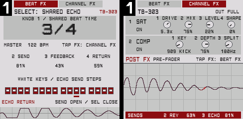

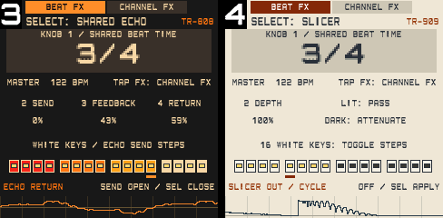

| Effect | What BEATS measures | Knob 2 | Knob 3 | Knob 4 | SEL |
| --- | --- | --- | --- | --- | --- |
| Echo | Spacing between repeats | Focused channel’s send | Repeat feedback | Global return | Open or close the Echo input |
| Flanger | One whole triangle sweep | Wet/dry mix | Comb feedback | Sweep width | Apply to the focused channel, or bypass there |
| Slicer | One whole 16-step pattern | Attenuation on unlit steps | — | — | Enable or bypass the focused channel |
| PCF | One whole 16-step filter rhythm | Resting cutoff | Resonance | Envelope amount | Enable or bypass the focused channel |

The selector runs from 1/16 to 4 quarter-note beats, including triplets and
dotted values. Changing tempo retimes all four effects. Flanger, Slicer and PCF lock
to song position during playback and keep cycling at the master BPM when stopped.
One Beat Flanger can be routed to any of the four strips after its insert slots.

On Echo, the **16 white keys** toggle the focused channel’s sixteen send steps.
Start with every step lit. Turn up Depth and turn off all but the first step
to echo the downbeat. All dry audio keeps playing and the repeats ring over
the closed steps. Stopping the sequencer suspends the step mask for live playing.
Browsing to Echo leaves the delay clock alone. Turning an Echo knob, pressing
SEL or toggling one of its send steps selects BEAT timing for the shared delay.

For an echo throw, start with **SEND CLOSED**. Press **SEL** just before the
hit you want to catch, then press it again. The dry mix carries on and the
captured hit echoes at the displayed beat interval. Closing the send applies
to all channels and stays in effect across stop and restart. To silence the
return immediately, bypass Delay in the GLO FX rack. Pressing SEL on Echo
with the return muted reopens the send and enables the return.

For a rhythmic cut, turn **SELECT** to **Slicer**, choose a channel with
**PRESETS**, set **BEATS** to **4**, then press **SEL**. The white keys now
edit one bar of sixteenths. Lit steps pass the channel audio. Unlit steps
attenuate it by **Depth**, down to silence at 100%. The factory pattern
passes the first eight steps and cuts the last eight. Try lighting steps
1, 5, 9 and 13 alone to pass the first sixteenth of each beat. The white
cursor under the grid follows the gate. Set BEATS to **1** and the same
pattern fits inside one quarter note. Each channel keeps its own pattern,
depth and bypass, so all four can run together. Slicing takes place after
the channel inserts, Beat Flanger and PCF, before the fader and sends.

| Punching in extra steps on a TB-303 | Holding an organ note through alternating steps |
| --- | --- |
| 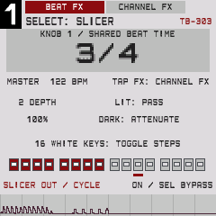 | 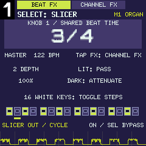 |

#### Play the pattern-controlled filter

Press **PLAY**, then **FX** from the instrument. Turn **SELECT** to **PCF** and **PRESETS**
to a 303 or drum channel. Set **BEATS** to **4** for a one-bar rhythm.
Tap the first black key for **QUARTERS**, then the second for **OFFBEAT**.
With that rhythm running, tap a white key to add or remove a trigger exactly
where you want it. The notes and the other strips keep their place.

| Black keys, left to right | 1 | 2 | 3 | 4 | 5 | 6 | 7 | 8 |
| --- | --- | --- | --- | --- | --- | --- | --- | --- |
| Filter rhythm | Quarters | Offbeat | Eighths | Sixteenths | Backbeat | Tresillo | Gallop | Pickup |

Black keys 9 and 10 select **low-pass** and **band-pass**.
Turning off a step and turning it back on restores the original accent. A new
trigger on a factory rest plays at full strength. Recalling a rhythm with a black
key restores its original accents. Each channel keeps its own edits.
Key positions stay fixed across octave changes. Turn **ALGORITHM** to shorten
or lengthen the filter envelope (10–2,000 ms). Each lit step opens the filter
by its programmed accent. A wider lamp marks a stronger accent, and a dark
step lets the envelope decay. At zero envelope amount, the filter stays at
the cutoff set by knob 2. **SEL** compares the filtered and dry signal.
Each strip starts bypassed and retains its own rhythm, mode and tone settings.

### Hear Saturator Shape on the 303

Press PLAY with pattern 01 on both 303s. In bar four, listen for the upper
303 sliding from B to E and then answering on G. The slide hardens and the G
returns to the softer curve. To watch it, select channel 2, tap FX twice from the instrument for Channel FX,
and turn SELECT to slot 1. Its Shape dial follows the phrase.

Both factory 303 channels have their own **SAT** in slot 1, followed by
**SIDECHAIN** in slot 2. Knobs 1–4 on the saturator set
Drive, Mix, Level and Shape. At 0% Shape the original soft knee rounds peaks.
At 100% the harder curve flattens them. Turn knob 4 to set the starting
shape, or press SEL to compare with the dry sound. The pattern adds to
your setting for one beat. The lower 303 stays on its own setting throughout.

### Hear the kick duck the bass

Select a factory 303 channel, tap FX twice for Channel FX and turn SELECT to slot 2,
**SIDECHAIN**. Press PLAY. Knob 1 starts
on **909 KICK**, the isolated kick before its fader. Keep it selected and
turn knob 2 from 0% to 100%. At 0% the insert keeps its makeup gain, so you
can compare depths at the same level between kicks. Listen to the bottom of
the 303 dip on each quarter and come back between hits. Knob 3 moves the shelf
up in frequency to duck more of the squelch as well. SEL compares the entire
insert, including makeup gain, with the dry 303.

With an organ assigned, try **M1 ORGAN** as the key. The bass makes room for chord stabs, even
with the organ fader down. Muting its SEQ track lets its release finish and
the ducking subside. **909 KIT** includes hats and claps in the detector.
**808 KICK** and **808 KIT** select the corresponding 808 sources independently.
**MONO** follows the monosynth and **303 SELF** follows the acid line's own
accents. Only the 303 is processed. The factory setting is 75% depth at
180 Hz, with a 2 ms attack and 90 ms recovery for full-depth moves.

The Channel FX scope shows the selected strip after its inserts and Beat FX,
just before its fader and sends. It keeps the same vertical gain while you adjust
depth, bypass the compressor or switch to the send controls. To flange the
compressed bass, replace slot 1's saturator with **FLANGER** and keep slot 2's
sidechain. Each slot keeps its own delay line.

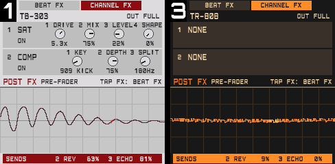

Each assigned 303 keeps its own key, depth, crossover and bypass. Named external sources sum all matching
channels before their faders. With two 909s assigned, a kick from either kit
can duck every 303. With 303 SELF selected, each 303 keys from its own signal.

## UI patterns

Tap **HOME** to back out one level. From a GLO strip this brings back all four
faders. Tap again to return to the instrument. From the SEQ tempo, recording
or step editor, HOME returns to the channel’s pattern.

Hold **HOME** for **0.6 seconds** for a compact guide to the current page.
Release it to resume on the same control. The transport and held notes
continue while the guide is visible.

**PRESETS** normally chooses the channel. In the explicit EDIT instrument
picker it chooses an instrument for the fixed channel. **ALGORITHM** chooses
a sound, waveform or sample on the instrument scope, or the effect type
for a selected insert on channel FX. The 303’s selected control takes over ALGORITHM until HOME
clears the selection.

## Building your own FM-1 app

This firmware uses [wavegraph-fm1-core](../wavegraph-fm1-core/) for CPU1
startup, graph handoff and DAC deadlines. The instruments, MIDI, mixer and
panel tasks live here. For a smaller starting point, see the
[one-oscillator firmware](../wavegraph-fm1-core/examples/tone.rs).

## Audio timing and stack measurements

Hold **SAVE** to read measurements since boot. Release it to return to the page
you were using. Press PLAY, switch between the instrument, SEQ, GLO, FX and ENV
pages, change a pattern and turn a knob before reading the display.

- **USP FREE B** and **SSP FREE B** are contiguous untouched bytes at the bottom
  of CPU0's 16 KiB user and 20 KiB supervisor stacks. The reset prefix paints both
  before Rust starts. The display scans the paint with interrupts enabled.
- **C1 FREE B** is the watermark of the 12 KiB CPU1 user stack. The worker samples
  its own painted stack and sends the result with a completed block.
- **REFILL US** is the maximum time from ALNK0 entry through a serviced refill,
  including a late return. **PLAY US** tracks the same peak while the transport
  is running. **WRITE US** shows the peak for successful DMA writes and **ALNK US** also
  includes the subsequent interrupt work. Times round up from the 24 MHz clock.
  Compare them with the 69,632-tick (2,901.3 µs) half-buffer period.
  **OVERRUNS** counts the BSP's late DMA, interrupt duration and service gap checks.
- **WORKER US** times graph rendering on CPU1. On the row above the stack
  counters, **R** is peak microseconds from CPU0 issuing a job to CPU1 being
  ready to publish it. **N** and **W** are minimum estimated microseconds left
  until the next nominal refill, on ordinary jobs and jobs that scan the stack
  watermark. CPU1 takes the timestamp before publishing. The estimate includes
  dispatch and scanning, uses CPU0's interrupt entry as the deadline anchor,
  and excludes the final mailbox send. Negative values indicate lateness.
  The cold priming job is excluded from these three measurements.

CPU0 opens the timing page when it detects a boot timeout, invalid context
or reply, CPU1 fault, or stalled renderer. One second without a current DAC
write opens **AUDIO STARVATION** even when the worker keeps returning expired
jobs. The controls remain live and a timely write clears the alarm. A silent
fallback also lights the overload dot and records a **DSP** event for USB logs. Hold both OCT buttons for two
seconds to return to the bootloader. If the panel stops responding, hold
REC while powering on to enter the bootloader directly.

To compare this firmware with the CPU0 renderer in `0f0f38b`, cold-boot each
image on the same FM-1 at the same MASTER level. Press PLAY on the factory
arrangement (two 303s, 808 and 909 at 122 BPM). Leave the default effects
enabled. Play for 32 bars, sweep the first 303's cutoff and cycle through GLO,
FX and the instrument scope at the same bars on both runs. Hold SAVE at the
end and compare **WORKER US**, **REFILL US**, **OVERRUNS**, **SILENCES** and
**DISCARDS**. The prep image exposes these fields on its LCD.

### The CPU1 render worker

CPU1 owns all four instruments, their sequencers, the mixer, sends and effects
for the lifetime of the renderer. It renders one 128-frame
block synchronously while CPU0 runs the panel, display and USB tasks under
RTICX. The board-specific startup and mailbox follow the FM-1 BSP’s [CPU1
bring-up][cpu1-probe] and [RTICX audio demo][cpu1-demo].

The mailbox assumes reliable, coherent SRAM. The BSP demo verifies each
sample of a known test waveform. WaveGraph renders arbitrary programs, so
its successful boot handshake cannot rule out the [load-dependent SRAM
misreads observed on one FM-1][cpu1-sram].

The render slot carries the exclusive reference to the graph's signal buses.
On a current completion, CPU0 reads the selected full- or half-gain pair of
master buses directly into the stereo output block. This removes the 512-byte worker PCM array and its per-block copy.
The output driver applies the physical MASTER ramp, exposes the post-gain scope
samples and copies the result into the released DMA half. This keeps the one-block
lookahead (about 2.90 ms). CPU0 publishes settings, changed chords, startup cue
and USB session to the slot. Only the core holding the slot can access its
payload. Scope and playhead updates follow a successful DMA write. Graph
edits use WaveGraph's async controller on CPU0 and the receipt names the
first frame accepted under the new revision. A separate CPU0 task waits for
the receipt, so other controls and USB MIDI continue while an edit is pending.
On a missed half, CPU0 retires the outgoing MIDI batch and queues All Notes
Off and slide reset for each channel. It also does this on terminal CPU1
failure. The first accepted block resends the session’s latched 303 controls,
slide and TB-03 delay settings before its own MIDI events. This also covers
an ambiguous refill where the next render begins at the adjacent logical frame.
Only accepted blocks can send new attacks. The next render advances
clip and arpeggiator clocks across skipped frames and chases clip automation.
Drums and effect tails resume from their existing DSP state.

When CPU0 services multiple DMA half releases in one interrupt, it advances
the output frame by the known number of skipped halves before selecting PCM.
If the BSP reports an ambiguous interval, CPU0 silences that refill, retires
the old job and resumes from the next logical half. The elapsed musical time
across an ambiguous interval is unknown. Neither case acknowledges an edit
on discarded PCM. A recorded DMA gap does not reveal what the DAC played
during the missed releases.

Factory-pattern and arpeggiator events retain their offsets within each block.
Live panel and USB MIDI input still update CPU0's key-state snapshot. Pressing
and releasing a note within a single snapshot interval can coalesce both edges.

[cpu1-probe]: https://github.com/fm1-rust/fm1-rust/pull/83
[cpu1-demo]: https://github.com/fm1-rust/fm1-rust/pull/84
[cpu1-sram]: https://github.com/charlesvestal/fm1-x0x/issues/10

The default build applies master output gain edits at the next available block. To exercise
the late-block fallback on the board, build with
`./wavegraph-fm1/build.sh --features late-block-probe`. In that build, press
PLAY and tap **GLO**, then **FX**, to open the master rack with no device
selected. Turn **ALGORITHM** right to establish full output and wait for the
**0 dB** footer. Hold **SAVE** and turn **ALGORITHM** one detent left for
half output. The change from full to half triggers the probe and holds
the edited job until ALNK0 writes a silent half. The worker then
returns the expired slot. On the next refill CPU0 discards it and issues a
fresh job. In an otherwise clean run **SILENCES** rises by two, **DISCARDS**
by one, and **EDIT BLOCK** is two greater than **DROP BLOCK**. Both block
numbers show the low 32 bits. **WORKER US** measures the longest render, excluding the
test gate. A DMA miss or a written fallback leaves the edit receipt pending.

For a separate dynamics comparison, build with `--features short-detector-probe`.
The master compressor then updates its target every four samples instead of
sixteen. The limiter still runs every sample. Compare the same four-track
passage, MASTER setting and page changes, checking both the sound and the
ordinary and watermark-scan margins on SAVE.

## Audio and display

Every 128-frame ALNK0 block merges frame-stamped factory pattern events with
live panel and MIDI changes in bounded per-channel queues. A swap replaces the
channel's processor at the start of a block, before its first control or note
message. The other processors and the shared returns continue with their current DSP
state. Each channel feeds the Q23 mixer, which produces dry, reverb and delay
buses. TAPE LOOP adds its playback to the dry bus before master processing.
One reverb and one mono digital delay run in parallel. The dry bus reserves
three bits of headroom for four boosted tracks. The master node restores that
gain and sums both returns and the startup cue in a widened accumulator. EQ,
compression, makeup and limiting precede output trim and the physical MASTER.
The delay uses 77,208 bytes. The first 375 ms uses native-rate PCM16, which
covers the factory 3/4-beat Echo at 122 BPM. Longer taps average every four
frames, then every sixteen beyond roughly 2 seconds, and store logarithmic
eight-bit PCM. Longer repeats therefore sound darker. The longest setting
covers four beats at 30 BPM (eight seconds).

The hot 303 preset reserves 16-fold output headroom before converting to Q23.
Its channel inserts sit between the synth and the channel fader, so both
post-fader sends hear the shaped acid line. The GLO faders and sends apply
to live and sequenced notes.
The master rack overview uses the async `EditQueue` to switch the output
gain program between blocks, with an acknowledgement once DMA accepts the
first block under that route.

Both 303 SRC scopes average five consecutive samples per pixel. A second
wrap-locked sweep can start once the first is half full, preserving the
1,200-frame time window for slides. Other scope taps capture 240 consecutive
samples and rearm on the next rising zero crossing or first attack after
silence. A silent tap publishes its flat line once.
A two-block queue feeds an async observer. Missing blocks and routing changes
start a fresh trace. The trace labels travel with the samples. The cutoff
readout follows the knob even while the scope waits for a trigger.

The splash uses [fm1-graphics] to draw a waveform on a 24-pixel grid. The
boot illustration combines two harmonics with phase modulation. The green WaveGraph title drops on the first low D
of the 750 ms acid cue, bounces on the accented A and settles on the first
909 knock. The pink FM-1 lettering then rises and lands on the high D and
closed hat. The firmware version from the `wavegraph-fm1` Cargo package appears
in bold white beneath the logo and stays on screen for 500 ms.
MASTER controls the cue throughout. Turning it fully down skips the rest
of the cue for that boot.

The monochrome UI fonts come from the public-domain X.Org misc-fixed faces in
`fm1_graphics::embedded_graphics::mono_font::ascii`. The host build packs the
upstream atlas pixels for upper flash. The firmware uses the same upstream
glyph mappings and metrics for layout.

The channel, instrument and effect pickers use Orbitron Bold, as do the
TB-303, TR-808, TR-909 and JP-8080 panels. The model marks and channel digits
are rasterized on the host at their LCD sizes. The build also packs each
12-pixel scanline of a picker glyph into a single word. At draw time the
selected instrument supplies the ink and background colors. Other dynamic
labels use the original two-bit coverage from the 12 × 16 grid atlas.
The panel blends grayscale coverage into its RGB565 strip.
The generator and Open Font License are in `assets/panel-type/`.

The 208 × 36 title and 104 × 38 model name occupy 2,860 bytes of packed
artwork. Both draw in buffered RGB565 strips. The scope stays live while the transport is stopped. During playback, a
narrow phosphor pulse crosses the trace once per quarter note, starting at
the left edge with the kick. It follows the audio master clock across tempo
changes and clears on STOP. The live scope compares the old and new trace and
pulse in six-column strips for the basses, organ and Super Saw, 24-column
strips for the drum kits and 12-column strips for mono and wavetable. During
channel selection, the waveform stays live behind the four-row list. When
the list and number close, the faceplate returns to full brightness with the
current sweep. A jump between notes leaves the clean rows between them alone.
A changed trace or label wakes the display, and
changes during painting coalesce into the next frame. Startup, panel, audio
and scope tasks on CPU0 each own a sender for that single redraw wake. Only
time-driven animations use a 20 ms fallback. Static pages wait for a change.
Page clears and solid bands use the BSP’s async rectangle fill. It sets one
panel window and stages the color once, then SPI1 repeats the strip while the
display task yields.
Sequencer labels and pattern buttons, drum faceplates and controls, and the
channel list use the same interrupt-driven writer.
Display DMA runs below audio and panel scanning. To change the lettering, edit `assets/wavegraph.png`
or `assets/fm1.png` and run
`python3 wavegraph-fm1/assets/pack_logo.py` with Pillow installed.

## Build and flash

The [firmware workflow] builds a `wavegraph-fm1` artifact containing
`wavegraph-fm1.fwsc` for M-Flasher and a raw `wavegraph-fm1.bin` for
emulators accepting an application image. For a local build, follow the
[FM-1 toolchain setup] for `RUSTC`, `PI32V2_BIN` and `PI32V2_ISA`, and set
`PI32V2_TARGET` to the SDK's `fm1/targets/pi32v2-none.json`. From the
WaveGraph workspace root run

```sh
./wavegraph-fm1/build.sh
```

Both files are written to `target/pi32v2-none/firmware/`. The build reports
both file sizes, the asset address, the end of the install and the whole sectors
available for growth. `Cargo.lock` selects `fm1`, `fm1-audio` and `fm1-rticx`
0.2.1, and `fm1-assets`, `fm1-controls` and `fm1-graphics` 0.2.0.
CI and release builds use the pi32v2 workflow from the `fm1-rticx/v0.2.1` tag.

The firmware workflow builds the FM-1's native master mixer in the
`wavegraph-fm1-native-mixer` artifact. To build it locally, run
`./wavegraph-fm1/build.sh --features fm1-audio/dsp`.
`--features pi32v2-simd` enables both this mixer and the Super Saw kernel.
The default image uses the same bus handoff and the portable mixer so it can
also play in the browser emulator, whose CPU lacks the paired saturating add.

By default the build packs the 909 closed hat, open hat and ride from their
original `.s16le` files. In each group of 32 samples it stores only the bits
needed to reproduce every signed PCM value. The three clips take 114,181 bytes
in flash, down from 148,124, and each voice decodes one sample at a time.

The default `lofi-samples` feature saves 81,563 bytes of sampler recordings.
The compact Amen uses 52,096 bytes. The two stabs and zap share its existing
64-byte IMA block decoder. To hear the original-rate bank with the same 909
and airhorn, run
`./wavegraph-fm1/build.sh --no-default-features --features packed-cymbals,packed-samples`.
That build plays the Amen at 24,400 Hz and streams the other three hits as
lossless PCM1. Both Amen renders contain exactly sixteen beats at 122 BPM.

For a raw sampler comparison with the 909 packed, run
`./wavegraph-fm1/build.sh --no-default-features --features packed-cymbals`.
With both packing features off, the hardware image still packs the zap and
both stabs to fit alongside the raw 909. Host builds can compare all four raw clips.

To cut a release, update the version in `wavegraph-fm1/Cargo.toml` and
`Cargo.lock`, then push a `wavegraph-fm1/vX.Y.Z` tag for that commit. The
[release workflow] checks the tag against the Cargo version, runs the host
tests and publishes two firmware builds on GitHub Releases. Flash
`wavegraph-fm1-X.Y.Z.fwsc` with M-Flasher to use the native FM-1 mixer
(`fm1-audio/dsp`). The raw `wavegraph-fm1-X.Y.Z.bin` uses the portable mixer
for emulators. The workflow copies that raw image from the
highest stable `wavegraph-fm1` release to `gh-pages` and requests a rebuild
of the [WaveGraph browser emulator]. If the push or build request fails, rerun
the `pages` job from the release workflow.

The `.fwsc` package contains the application area for the hardware updater.
For [fm1-emu]'s native `fm1-live`, place the raw application at offset
0x120 within its XIP window. From the firmware output directory run

```sh
head -c 288 /dev/zero > wavegraph-fm1.xip.bin
cat wavegraph-fm1.bin >> wavegraph-fm1.xip.bin
fm1-live --bin wavegraph-fm1.xip.bin --entry 0x02000120
```

### Flash layout

The `.fwsc` installs two checksummed files. The `fm1-assets` linker script
places the factory assets on the first 4 KiB boundary after `app.bin`, including
the code and data copied into RAM at startup. The sequencer, sampler and
renderer read the assets directly through the flash controller's XIP mapping.

| Physical flash offsets (end exclusive) | Contents |
| --- | --- |
| `0x00000..0x04000` | Installed bootloader and unit configuration. M-Flasher preserves this area on a firmware install. |
| From `0x04000` | Application directory and `app.bin` (entry at physical `0x04120`). The locked BSP still limits the end of `app.bin` to `0x93000`. |
| Next sector after `app.bin`, up to `0xE0000` | The `assets.bin` file holds the 909 hats and ride, the rave sample bank and its credits, both wavetable banks and their catalog, the boot cue and its seek table, both splash bitmaps, the display font atlases and panel lettering, the 80 compiled MIDI patterns and their attribution. |
| `0xE0000..0x100000` | Outside the package, including the final unit-specific MAC sector. |

M-Flasher installs through the last occupied asset sector. A first install can
overwrite stock settings or Felucca projects, samples, and presets in that range.
Keep a full flash backup to recover those data when switching firmware. Subsequent
installs write only changed sectors. M-Flasher labels the range through the end of
`assets.bin` as **FIRMWARE** on its map. When code growth moves the asset file
to a new sector, the installer may rewrite its contents. The raw emulator
`.bin` preserves both files' linked addresses. [M-Flasher firmware installation][flasher-install]
and [FM-1 flash layouts][flash-layout].

## License

The firmware source is available under the [Apache License, Version 2.0](LICENSE-APACHE)
or the [MIT License](LICENSE-MIT).

[sh101]: https://support.roland.com/hc/en-us/articles/201921519-SH-101-Technical-Specifications
[tb03]: https://static.roland.com/assets/media/pdf/TB-03_e02_W.pdf
[korg-m1]: https://www.korg.com/us/products/software/kc_m1/
[fm1-graphics]: https://docs.rs/fm1-graphics/0.2.0/fm1_graphics/
[firmware workflow]: https://github.com/fm1-rust/wavegraph/actions/workflows/wavegraph-fm1.yml
[release workflow]: https://github.com/fm1-rust/wavegraph/actions/workflows/release-fm1.yml
[WaveGraph browser emulator]: https://wavegraph.org/
[flasher-install]: https://github.com/jvitkauskas/m-flasher/blob/8fbece7348d758ac284325eed455781675ac95ff/src/ops.rs#L360-L405
[flash-layout]: https://sbegueria.github.io/fm1-dev-wiki/Flash-Storage.html
[fm1-emu]: https://github.com/joakimeriksson/fm1-emu
[FM-1 toolchain setup]: https://github.com/fm1-rust/fm1-rust/blob/4c6a3fe082ec013ff594a06b8cd377a65bd96ffb/fm1/README.md#build-and-flash

[accent-sweep]: https://www.firstpr.com.au/rwi/dfish/303-unique.html
[audio-realism]: https://www.audiorealism.se/uploads/4/5/5/4/45545237/abl3-operation-manual.pdf
[transisthor]: https://www.reasonstudios.com/shop/product/transisthor-bass-and-rhythm/
[pump-panel]: https://daily.redbullmusicacademy.com/2019/02/blade-303/
[devil-fish]: https://www.firstpr.com.au/rwi/dfish/Devil-Fish-Manual.pdf
[od2]: https://articles.boss.info/boss-px-1-plugout-fx-dm-2-dc-2-and-od-2-model-passes/

[stock-seq]: https://fuleo.github.io/fm1-guide/sequencer.html
