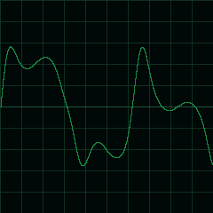

# WaveGraph for the FM-1

Play the [monosynth](../wavegraph-monosynth/) and [303 bass synth](../wavegraph-303/)
together on the M-VAVE FM-1. The firmware starts on the green monosynth page
with a sine selected and the cutoff at 5 kHz. Turn PRESETS one click in
either direction for the silver TB-303 page. Both instruments are playable
during the boot animation.

| Monosynth | 303 bank 1 | 303 bank 2 |
| --- | --- | --- |
|  |  |  |

| Control | Action |
| --- | --- |
| PRESETS encoder | Select the instrument for new key presses, panel edits and the display. |
| Piano keys | Play F3 to G5. Each instrument sounds its most recently pressed key. |
| ALGORITHM encoder | Monosynth cycles through sine, triangle, sawtooth and square. The 303 switches between saw and square. |
| SELECT encoder | Monosynth transposes up or down by up to 12 semitones. On the 303, turn one click either way to switch knob banks. |
| Knob 1 on the monosynth scope | Sweep the low-pass cutoff from 10 Hz to 20 kHz. Six detents span an octave. The header shows the cutoff in Hz. |
| ENV | Open or close the selected instrument’s envelope view. The button stays lit while the view is open. |
| Knobs 1–4 in monosynth ENV | Adjust attack, decay, sustain and release respectively. |
| Knobs 1–4 on the 303 | Edit the four assignments shown above the scope. The active knob is highlighted and its value appears below the trace. |
| MASTER | Set the volume of the stereo mix. |
| PLAY/STOP | Reserved for a future sequencer. |
| FX | Switch the mix between dry and half gain. |
| SEL button | Switch the scope between the selected voice before FX and MASTER (VCA on the monosynth, SRC on the 303) and the stereo mix after MASTER (DAC). |
| Both OCTAVE buttons | Hold for two seconds to return to USB download mode. |

| 303 bank | Knob 1 | Knob 2 | Knob 3 | Knob 4 |
| --- | --- | --- | --- | --- |
| B1/2 | Cutoff | Resonance | Filter env mod | Filter decay |
| B2/2 | Tuning (±12 semitones, 10 cents per click) | VCA attack (0–60 ms) | Accent amount (0–100%) | Overdrive (0–36 dB into the filter) |

SELECT updates the bank indicator and all four labels, including when the keys
are idle. Returning to a bank recalls its settings and last-touched knob.

Hold a monosynth note, turn PRESETS, then play a different key for the 303.
Each key controls its own voice and release tail. Within each part,
releasing the newest key recalls the previous key and its strike velocity.
On the 303, strikes at velocity 96 and above trigger accent. Overlapping keys
slide, and a fresh strike after release restarts the envelopes.

## VCA envelope

Hold a key and turn Knob 3 to hear the sustain level change. Release the key
and turn Knob 4 to shorten or extend the tail. The graph and readouts also
respond while the keyboard is idle. Press ENV again to return to the scope.
Turning PRESETS to the 303 closes the editor and keeps the monosynth settings.

| Knob | Parameter | Range | Initial value |
| --- | --- | --- | --- |
| 1 | Attack | 1.5 ms–4 s | 8 ms |
| 2 | Decay | 2 ms–10 s | 160 ms |
| 3 | Sustain | 0–100% | 70% |
| 4 | Release | 2 ms–10 s | 125 ms |

The time ranges follow the [Roland SH-101][sh101]. The editor scales each
stage's width by knob position so you can see a short attack next to a long
release. The flat section shows the level held until key-up.


## 303 envelope preview

Press ENV on the silver 303 page. The display plays a silent reference phrase
through a separate instance of the voice’s envelopes. PLAIN marks one ordinary
strike. The three A marks are accented strikes 96 ms apart. Each vertical grid
division is 96 ms. Turn SELECT to switch knob banks while the preview is open.

| Trace | What to try |
| --- | --- |
| VCF · filter cutoff (62.5 Hz–16 kHz, logarithmic) | Raise Env Mod to deepen the sweep. Decay stretches the plain strike. Accented strikes keep their short filter decay, about 200 ms to 1% in this model. |
| ACC · accent contribution to cutoff (0–3 octaves) | Raise Accent on bank 2, then Resonance on bank 1. The later accents start with charge left by the previous strike. Higher resonance slows the drain. |
| VCA · amplitude gain (0–1.9) | Turn bank 2 knob 2 to lengthen the attack. Accent also boosts the gain. |

To isolate the rounded sweep, turn Env Mod down to zero and raise Accent and
Resonance. On the original 303, some direct filter modulation remains at
minimum Env Mod.

The hardware uses a second section of the resonance pot and a 1 µF capacitor
in its accent sweep. WaveGraph approximates that branch with a 12 ms charge
time constant and an 80–430 ms drain. The preview uses the same equations as
the audio voice. [Robin Whittle’s circuit description][accent-sweep]

| Main envelope and accents | Accent sweep with Env Mod at zero |
| --- | --- |
|  |  |

## Audio and display

Every 128-frame ALNK0 block calls both persistent WaveGraph nodes. The graph
trims the 303 to quarter gain, adds both voices, and sends the mix to both
stereo channels. FX uses the async `EditQueue` to switch the gain stage
between blocks. The edit is acknowledged when DMA accepts the first block
using the new route.

The scope captures 240 consecutive samples starting at a rising zero crossing.
A two-block queue feeds an async observer. Missing blocks and routing changes
start a fresh trace. The trace labels travel with the samples. The cutoff
readout follows the knob even while the scope waits for a trigger. A red LATE
indicator latches if audio service misses its timing budget.

The splash and instrument pages use [fm1-graphics] to draw a waveform on a
24-pixel grid. The boot illustration combines two harmonics, with phase
modulation. The logo
slides over it in buffered RGB565 strips. During play, dirty tiles update the
trace and a narrow phosphor sweep highlights it. Display DMA runs below audio
and panel scanning. The 208 × 36 logo occupies 1,872 bytes in firmware.
To change it, replace `assets/wavegraph.png` and run
`python3 wavegraph-fm1/assets/pack_logo.py` with Pillow installed.

## Build and flash

The [firmware workflow] builds a `wavegraph-fm1` artifact containing
`wavegraph-fm1.fwsc` for M-Flasher. For a local build, follow the
[FM-1 toolchain setup] for `RUSTC`, `PI32V2_BIN` and `PI32V2_ISA`, and set
`PI32V2_TARGET` to the SDK's `fm1/targets/pi32v2-none.json`. From the
WaveGraph workspace root run

```sh
./wavegraph-fm1/build.sh
```

The image is written to `target/pi32v2-none/firmware/wavegraph-fm1.fwsc`.
Cargo resolves the FM-1 SDK from crates.io, including `fm1` 0.1.3 and
`fm1-rticx` 0.1.1. CI uses the SDK’s shared pi32v2 build workflow to package
the flashable image.

## License

The firmware source is available under the [Apache License, Version 2.0](LICENSE-APACHE)
or the [MIT License](LICENSE-MIT).

[sh101]: https://support.roland.com/hc/en-us/articles/201921519-SH-101-Technical-Specifications
[fm1-graphics]: https://docs.rs/fm1-graphics/0.1.0/fm1_graphics/
[firmware workflow]: https://github.com/fm1-rust/wavegraph/actions/workflows/wavegraph-fm1.yml
[FM-1 toolchain setup]: https://github.com/fm1-rust/fm1-rust/blob/953165a87c12fac5bc1e2897d13e38a3045bbf69/fm1/README.md#build-and-flash

[accent-sweep]: https://www.firstpr.com.au/rwi/dfish/303-unique.html
