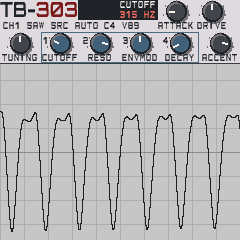
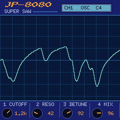
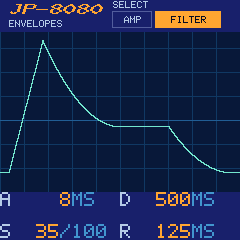
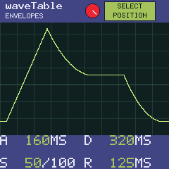
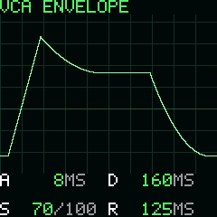
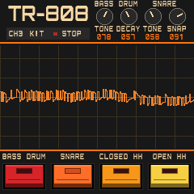
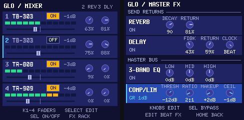

# WaveGraph for the FM-1

WaveGraph gives the M-VAVE FM-1 four assignable mixer channels. It opens on
the first [TB-303](../instruments/wavegraph-303/). Press PLAY to start this
four-bar acid-house arrangement at 122 BPM. PRESETS moves between channels.

| Channel / USB MIDI | Instrument | Factory part |
| --- | --- | --- |
| 1 | TB-303 · saw | The original sliding bassline, with cutoff, resonance and drive automation. |
| 2 | TB-303 · square | A higher answer drawn from the former M1 chords. Held-gate slides connect C to F and B to E. |
| 3 | [TR-808](../instruments/wavegraph-808/) | Syncopated bass drum, ghost snares and hat pickups between the 909 hits. |
| 4 | [TR-909](../instruments/wavegraph-909/) | Four-on-the-floor kick, backbeat snare and clap, and offbeat closed hats. |

All four patterns start enabled. GLO lets any channel host any instrument,
including the [monosynth](../instruments/wavegraph-monosynth/),
[M1-inspired organ](../instruments/wavegraph-organ/),
[Super Saw](../instruments/wavegraph-supersaw/) and
[wavetable synth](../instruments/wavegraph-wavetable/).
The transport starts stopped. You can play the panel keys immediately.
The default build tries to start USB MIDI at boot. The current AC791N BSP
returns `DmaProtectionUnavailable`, so the synth runs locally with USB MIDI and
`fm1 log` offline. The firmware updater remains available through the bootloader.

| Monosynth | 303 direct knobs | 303 editing Drive |
| --- | --- | --- |
|  |  |  |

| Control | Action |
| --- | --- |
| PLAY/STOP | Start all enabled patterns on beat one from any page (green). Press again to release sequenced notes, silence the kit and stop (red). Live held keys keep sounding. |
| LFO on a TB-303 | Open the channel’s modulation page. LFO or HOME returns to the instrument. |
| SEL in LFO | Enable or bypass modulation. Each 303 starts bypassed with a 5 Hz sine routed to pitch at 25% depth. |
| KNOBS 1–4 in LFO | Set waveform, rate, depth and destination. Pitch gives up to ±2 semitones of vibrato around the tuning knob. The other destinations are cutoff, resonance, env mod, decay, accent, attack and overdrive. |
| SELECT in LFO | Clockwise selects tempo divisions from two bars to a sixteenth. Playback start resets the synced waveform. Counterclockwise selects 0.1–20 Hz. |
| MIDI CC1 | The mod wheel sets the same depth as knob 3 on the addressed 303, from zero to full. SEL remains the bypass switch. USB MIDI uses the existing `qualified-usb` build. |
| ARP on an instrument | Open that channel’s arpeggiator. ARP or HOME returns to the instrument. PRESETS browses channels while the editor is open. |
| SEL in ARP | Enable or bypass the displayed channel’s arpeggiator. Each channel starts bypassed. |
| KNOBS 1–4 in ARP | Set order (up, down, up/down, as played, random), rate (1/4 through 1/32, including triplets), octave range (1–4), and gate (1–100%). |
| SELECT in ARP | Turn clockwise to latch the chord. Release all keys and play a new chord to replace it. Turn counterclockwise to release unheld keys. |
| SEQ | Open the current instrument’s pattern bank. SEQ or HOME returns to its instrument. |
| Piano keys in the SEQ pattern view | The first eight white keys (F through the next F) select slots 1–8. The active slot flashes. |
| REC | Start live recording on the current channel. REC ends recording and keeps the loop playing. PLAY stops both. |
| EDIT in SEQ | Open or close the step editor. KNOB 1 moves the cursor and KNOB 2 selects a bar. Play a key to write at the cursor. |
| SEL held in the step editor | Tap a key to erase, or press EDIT to restore the factory step. |
| PRESETS in SEQ | Browse channels 1–4 while staying in the sequence view. |
| KNOB 2 in the pattern bank | Browse the bars of the selected clip while stopped. While playing, the view follows the audio playhead. |
| SEL in the pattern bank | Mute/unmute the displayed pattern. The other patterns and master clock continue. |
| SELECT in the pattern bank | Turn clockwise for the tempo page, then use KNOB 3 for 30–300 BPM in 1 BPM steps. Turn SELECT back or press the lit HOME button to return to the pattern. |
| PRESETS encoder | Cycle channels 1–4. On the main instrument scope, changing channels flashes the new channel number in the upper-left corner for 1.5 seconds. New notes go to that channel. Held keys keep theirs. |
| Piano keys outside the pattern view | Play F3 to G5 at the default octave, or play drum sounds on the first four white keys for the 808 and the first six for the 909. Each pressed key lights up. |
| OCT− / OCT+ | Lower or raise the piano roll by one octave, up to three either way. The setting follows you across presets and pages. Held keys keep their pitch. The button for the active direction blinks slowly at one octave, blinks faster at two and stays lit at three. |
| ALGORITHM encoder | Change mono waveform, switch organ House/Analog harmonic recipes, choose 303 saw/square, or select a wavetable bank. While a 303 knob is selected, ALGORITHM adjusts its value. |
| SELECT encoder on the scope | Transpose the monosynth, organ, Super Saw or wavetable by ±12 semitones, or cycle through all eight 303 knobs. |
| Knob 1 on the monosynth scope | Sweep the low-pass cutoff from 10 Hz to 20 kHz. Six detents span an octave. The header shows the cutoff in Hz. |
| Knobs 1–4 on the organ scope | Tone, key percussion, transient decay (5–500 ms), release (0–1000 ms). The charcoal panel shows the last-touched value. |
| Knobs 1–4 on the wavetable | Set START, END, one-way TIME and scan MODE. In ENV mode knob 3 sets position attack. |
| Knobs 1–4 on the Super Saw | Set low-pass cutoff (10 Hz–20 kHz), resonance, detune and side-saw mix. |
| ENV | Open or close the monosynth, organ, 303, Super Saw or wavetable envelope page. ENV stays lit while the page is open. |
| Knobs 1–4 in monosynth, organ, Super Saw or wavetable ENV | Adjust attack, decay, sustain and release. Turn SELECT or press SEL to switch between AMP and FILTER on Super Saw, or AMP and POSITION on wavetable. |
| Knobs 1–4 on the 303 | Adjust Cutoff, Resonance, Env Mod and Decay, including while ALGORITHM edits another knob. |
| HOME while editing a 303 knob | Clear the selection and turn off the HOME lamp. ALGORITHM selects saw or square again. |
| MASTER | Set the volume of the stereo mix (independent of the mixer faders). |
| GLO | Open or close the four-channel mixer. GLO stays lit while the mixer is visible. |
| Knobs 1–4 in the GLO overview | Set channel faders 1–4 independently. |
| SELECT in mixer | Open channel edit and move between the four strips. The selected strip is highlighted. |
| Knobs 1–3 in channel edit | Set the fader, reverb send and delay send on the highlighted channel. |
| PRESETS in channel edit | Browse and immediately assign an instrument to the highlighted channel. |
| HOME in channel edit | Return to the mixer overview. Press HOME again to return to the instrument. |
| FX on an instrument | Open the channel’s two insert slots and live post-FX scope. Turn SELECT to pick a slot and PRESETS to assign an effect. For 3-BAND EQ, knobs 1–3 adjust low, mid and high by ±12 dB. Press SEL to bypass the selected effect. HOME returns to the sends, where knobs 2 and 3 set reverb and delay. |
| GLO then FX, or FX then GLO | Open the global rack. SELECT highlights a device. HOME clears the highlight, then returns to the page that opened the rack. |
| FX or GLO in the global rack | FX returns to the mixer, keeping the selected strip if you entered from channel edit. GLO returns to the current instrument’s FX. |
| SEL in a global device or 303 insert | Toggle that device. The SEL lamp shows its enabled state. |
| ALGORITHM in FX | Switch the full/half post-rack output gain. |
| SEL button (instrument view) | Switch the scope between the selected voice (VCA for mono, ORG for organ, SRC for 303, OSC for Super Saw and wavetable, KIT for either drum machine) and the post-MASTER DAC mix. |
| Both OCTAVE buttons | Press together to return the piano roll to its default octave. Hold both for two seconds to enter USB download mode. |

The silver 303 faceplate puts a 240 × 176 live scope below the six sound knobs.
Tuning, Cutoff, Resonance, Env Mod, Decay and Accent follow the order on the
[Roland TB-03][tb03]. The four numbered encoders map to the boxed, blue-gray
knobs in the middle. Turn SELECT clockwise to select Attack, then Drive, then the
six dials from Tuning to Accent. One click counterclockwise
from idle goes straight to Drive.

The selected cap turns neon green with a black pointer and HOME lights up.
ALGORITHM adjusts that knob, and the display beside the logo shows its value
even while you turn a numbered encoder. Press HOME to finish. With the
selection cleared, the display shows the last knob you adjusted. Tuning covers
±12 semitones in 10-cent steps, Attack spans 0–60 ms, Accent spans 0–100% and
Drive adds 0–36 dB before the filter.

Each cap points to its saved setting. During pattern playback a separate red
mark on each automated knob follows the sequencer. The marks disappear when you play the 303 live, mute its pattern or stop playback.
The scope opens on the selected 303’s pre-fader signal (SRC). Each sweep starts
at an oscillator phase wrap and shows 27.2 ms of filtered audio, about two
cycles of the factory bass line’s low D. The fixed time scale lets you see the
cycles draw closer together on an upward slide. Automatic
sensitivity fits each sweep to the display and stops boosting below −36 dBFS
so tails fade to a flat line. Press SEL to see the master mix (DAC) at its
fixed scale.

Hold a bass note on channel one, turn PRESETS to channel two, and play the
upper voice. Each key keeps the channel it was pressed on. The 303 and
monosynth use last-note priority. On the 303, velocity 96+ triggers accent,
overlapping notes slide, and a fresh strike after release restarts the
envelopes. On the organ and wavetable synth, the latest four physical keys take priority.
Releasing a newer key restores an older held key.

## M1-inspired organ

The organ is **modeled, not sampled**. ALGORITHM selects either a 1:3:6
harmonic recipe (House) or a brighter 1:4:8 blend (Analog). Both include
short key percussion with its own decay and a separate per-voice amplitude envelope.
The modeling follows independent community recipes, not Korg's actual PCM
multisample. No Korg ROM data is bundled. For a proper similarity check,
compare a dry Organ 2 patch in the Korg M1 plug-in against both modes; a
spectrum and envelope comparison would be more informative than a single
house-music recording.

The organ's dark charcoal panel with lime accents and a cyan readout takes
visual inspiration from the [KORG Collection M1 V2 UI][korg-m1]. The PRESETS
list is inspired by the FM-1's stock patch-selector overlay. A bright outline
and dark fill mark the selected row over the dimmed instrument page. The scope
and controls stay live while browsing channels. The list closes one second after the
last turn.

## Super Saw

Press **GLO**, turn **SELECT** to highlight a strip, then turn **PRESETS** to
**SUPER SAW**, the entry after TR-808. Press **GLO** again to play it.
The strip keeps its MIDI channel, level and sends. Each assigned instance has
its own seven oscillators and panel settings.

On the blue JP-8080-style panel, knob 1 (**CUTOFF**) sweeps the low-pass in
six detents per octave. Knob 2 (**RESO**) emphasizes frequencies around the
cutoff. Knob 3 (**DETUNE**) spreads the six side saws, and knob 4 (**MIX**)
sets their level around the center saw. The 240 × 168 scope opens
on the filtered voice (**OSC**). Press **SEL** to see the
post-MASTER mix (**DAC**). The small display shows the channel and the held
key, or the pattern status during playback. The four-bar pattern leaves space
between sustained upper notes so the beating is audible.

Press **ENV** for the matching blue envelope editor. Turn **SELECT** or press
**SEL** to switch the amber tab between **AMP** and **FILTER**. The four knobs
edit attack, decay, sustain and release for the highlighted envelope. Each
strip remembers both contours. To hear the filter envelope, hold a low note,
lower the base cutoff to about 500 Hz, raise resonance, then lengthen FILTER
attack. Lengthening AMP release also lets you hear the filter close after key-up.

| Super Saw panel | Filter envelope |
| --- | --- |
|  |  |

## Wavetable

Press **GLO**, turn **SELECT** to highlight a channel and turn **PRESETS** to
**WAVETABLE**, one detent past **SUPER SAW**. Press **GLO** again to play it.
**ALGORITHM** switches between two 64-frame programs. Each remembers its
scan settings and position envelope for as long as the instrument occupies the strip.

| Program | Try it |
| --- | --- |
| Resonant Saw | Hold a low note and turn knob 1 (**START**) to step through the resonances. Turn knob 4 (**MODE**) one click to SMOOTH for intermediate timbres. |
| Vocal Formants | Roll a chord and let it ring. Each key starts its own sweep. Turn knob 3 (**TIME**) to slow the vowels down and knob 2 (**END**) to narrow the range. |

START and END run from 0 to 127. TIME covers 50 ms to 8 s per traversal.
ONCE holds the end frame and PINGPONG returns through the same frames.
The red dial and FRAME readout show the newest sounding voice's position
(0–63). The 240 × 168 scope shows its channel's complete polyphonic output,
with automatic gain. **SEL** switches to the master mix at fixed gain.
**PLAY** brings in a four-bar chord part with space for each voicing to evolve.

For a vowel that opens on each keystroke, select **Vocal Formants** and turn
knob 4 one click clockwise from **PINGPONG** to **ENV**. Knob 3 now sets
**ATTACK**. Hold a chord and turn it up to hear each note take longer to
reach END. Press **ENV**, then turn **SELECT** or press **SEL** to switch
between the strip's **AMP** envelope and the program's **POSITION** envelope.
Knobs 1–4 edit attack, decay, sustain and release on the displayed curve.
At 50% position sustain, each held key settles halfway between START and END.
Lengthen AMP release to hear the sweep return to START after key-up.

The blue face, red encoder and green readout draw on the original
[Waldorf Microwave panel][microwave]. The [instrument guide][wavetable]
covers the scan engine and the sources of both banks.

| Vocal Formants on the scope | Wavetable position envelope |
| --- | --- |
|  |  |

[microwave]: https://waldorfmusic.com/microwave-1/
[wavetable]: ../instruments/wavegraph-wavetable/

## VCA envelope

Hold a key and turn Knob 3 to hear the sustain level change. Release the key
and turn Knob 4 to shorten or extend the tail. The graph and readouts also
respond while the keyboard is idle. Press ENV again to return to the scope.
Switching instruments with PRESETS closes the editor. Each part recalls its own settings.

| Knob | Parameter | Monosynth range (initial) | Organ range (initial) |
| --- | --- | --- | --- |
| 1 | Attack | 1.5 ms–4 s (8 ms) | 0–4 s (4 ms) |
| 2 | Decay | 2 ms–10 s (160 ms) | 0–10 s (180 ms) |
| 3 | Sustain | 0–100% (70%) | 0–100% (68%) |
| 4 | Release | 2 ms–10 s (125 ms) | 0–1 s (180 ms) |

On the organ, knob 4 edits the same release in either view, in 5 ms steps.
Knob 3 on the scope sets the key click's decay. On the ENV page, lower sustain
to hear knob 2 shape the decay of the whole note.

The monosynth ranges follow the [Roland SH-101][sh101]. The editor scales each
stage's width by knob position so you can see a short attack next to a long
release. The flat section shows the level held until key-up.



## 303 envelope preview

Press ENV on the silver 303 page. The display plays a silent reference phrase
through a separate instance of the voice’s envelopes. PLAIN marks one ordinary
strike. The three A marks are accented strikes 96 ms apart. Each vertical grid
division is 96 ms. The numbered knobs keep their assignments here. Turn SELECT
to choose any 303 parameter, then ALGORITHM to edit the value below the traces.
HOME clears the selection. Press it again to return to the scope.

| Trace | What to try |
| --- | --- |
| VCF · filter cutoff (62.5 Hz–16 kHz, logarithmic) | Raise Env Mod to deepen the sweep. Decay stretches the plain strike. Accented strikes keep their short filter decay, about 200 ms to 1% in this model. |
| ACC · accent contribution to cutoff (0–3 octaves) | Select Accent and raise it with ALGORITHM, then raise Resonance with knob 2. The later accents start with charge left by the previous strike. Higher resonance slows the drain. |
| VCA · amplitude gain (0–1.9) | Select Attack and turn ALGORITHM to lengthen it. Accent also boosts the gain. |

To isolate the rounded sweep, turn Env Mod down to zero and raise Accent and
Resonance. On the original 303, some direct filter modulation remains at
minimum Env Mod.

The hardware uses a second section of the resonance pot and a 1 µF capacitor
in its accent sweep. WaveGraph approximates that branch with a 12 ms charge
time constant and an 80–430 ms drain. The preview uses the same equations as
the audio voice. [Robin Whittle’s circuit description][accent-sweep]

| Main envelope and accents | Accent sweep with Env Mod at zero |
| --- | --- |
|  |  |

## TR-808 instrument view

Turn PRESETS to channel three to play the factory 808. To put another 808
on any channel, press GLO, turn SELECT to highlight its strip, and turn
PRESETS to **TR-808**. The strip keeps its MIDI channel, fader, sends and
sequence mute. Press HOME twice to return to the instrument.

The four red, orange, amber and yellow switches show the actual voices in that strip. A strike depresses the cap and lights
the lens. The lamp dims through the tail and goes dark when the voice stops.
The scope shows the pre-fader kit, and SEL switches it to the master output.
Knobs 1–4 adjust kick Tone, kick Decay, snare Tone and Snappy. Each dial shows
its current value.

| Switch | Panel key | USB MIDI note |
| --- | --- | ---: |
| Bass drum | F3 | 36 |
| Snare | G3 | 38 |
| Closed hi-hat | A3 | 42 |
| Open hi-hat | B3 | 46 |

The factory 808 plays between the 909's hits. Short sub kicks answer the main
kick, ghost snares punctuate the bar turns, and open hats lead into the next
phrase. A closed hat chokes its ringing open partner. MIDI strike velocity
sets each voice's excitation.



## TR-909 instrument view

Select a TR-909 channel with PRESETS to see its pre-fader kit waveform. SEL
switches the trace to the final DAC mix. The orange pulse follows the transport.
The six key lamps follow this kit in either scope mode. Each lamp flashes at
the attack and glows dimly through the tail. A closed hat cuts off an open hat
immediately.

Press PLAY to watch the pattern, or trigger the lamps and voices from the
panel or USB MIDI with the transport stopped. The six physical pads keep their
assignments across octave changes. SEQ opens the drum pattern and HOME returns
to the same live view.

| Voice | Panel key | USB MIDI note |
| --- | --- | --- |
| Kick | F3 | 35, 36 |
| Snare | G3 | 38, 40 |
| Clap | A3 | 39 |
| Closed hat | B3 | 42, 44 |
| Open hat | C4 | 46 |
| Ride | D4 | 51 |

## Pattern banks

Press **SEQ**, turn **PRESETS** to the instrument you want, and press one of the
eight lit white keys. **F, G, A, B, C, D, E, F** select the numbered slots from left
to right, even after an octave change. The pressed key and its on-screen button
blink off and back on once to acknowledge the press. While stopped,
a selection immediately previews bar one. During playback, the grid and flashing
key follow the sounding clip. An underline and **QUEUED** identify the incoming
slot. Press another key to replace the request or the active key to cancel it.

Each channel starts its new clip at step one on the next bar line. The other
channels continue wherever they are in their phrases. This adapts ReBirth’s
independent pattern selectors to WaveGraph’s multi-bar loops. Each strip
remembers its selection for each instrument until power-off. **SEL** mutes the
displayed channel. **KNOB 2** browses its bars while stopped. Turn **SELECT**
clockwise and use **KNOB 3** to set the master tempo. [ReBirth operation manual,
pp. 19–21][rebirth] · [TB-03 owner's manual][tb03-manual]

| Key | Pattern | Bars | Factory rack |
| --- | --- | ---: | --- |
| F | 1 · Original | 4 | Sliding low 303 and high square answer over the four-on-the-floor 909. The 808 fills the gaps. |
| G | 2 · Undertow | 2 | Low fifth-to-seventh slides answer the high line. Backbeat claps alternate with snares and an open-hat pickup. |
| A | 3 · Jack Track | 1 | Octave bass stabs, a climbing upper voice and an extra 909 kick just before beat four. |
| B | 4 · Negative Space | 2 | An off-downbeat bass leaves room for syncopated hats and a sparser backbeat. |
| C | 5 · Acid Trip – Pulse | 1 | The low 303 jumps octaves under a sparse upper answer. The 808 plays the backbeat against a four-on-the-floor 909. |
| D | 6 · Acid Trip – Full Kit | 1 | The bass slides up from the seventh. Ghost snares, claps and offbeat open hats fill out the groove. |
| E | 7 · Acid Trip – Break | 2 | A chain of 303 slides rides over a kickless bar of sixteenth-note hats. The kick returns under a snare roll in bar two. |
| Higher F | 8 · Devil Fish | 1 | The open-hat steps of the source groove lift the bass into four accented high notes. The second 303 answers above the backbeat. |

Slots 5–8 adapt two demo songs by **verytired** from the MIT-licensed
AfterBirth AB-3389. Both 303 lines are transposed from C to D to sit alongside
the factory bassline. The monosynth, M1 organ, Super Saw and wavetable each
have eight clips, with their own voicings and rhythms. [Pattern sources and kit mappings](patterns/README.md)

The melodic grid shows note lengths. On a 303, **A** marks an accent and **S**
a note entered with slide. Three traces show the cutoff, resonance and drive
messages in the clip. The drum grid puts each voice on its own row with sixteen
steps grouped in fours. The charcoal 808 has four voice lanes and the ivory 909
has six. The lower strip follows the current step. [ReDrum drum computer][redrum]

| TR-808, queued change | TR-909, pattern 8 |
| --- | --- |
|  |  |

Live keys outside the pattern view temporarily take over their melodic channel.
Releasing them rejoins the clip at the next scheduled note. Inside the pattern
view the piano keys operate the bank. USB MIDI still addresses its assigned
instrument. The transport, gates and controller events share the existing
audio-frame clock. Changing tempo retains the position within the step.

### Recording and step editing

Choose a pattern, then press **REC** and play the piano roll. The REC lamp lights
and the transport starts if stopped. Each strike uses the sixteenth currently
sounding on that channel, including its local bar and bank slot during a queued
change. New notes keep the panel velocity and octave or drum-pad mapping. They
repeat with a gate of three quarters of a sixteenth. Press **REC** to finish the
take while the loop continues. Leaving REC or changing channels also disarms it.

Press **EDIT** in SEQ for a stationary cursor. Turn **KNOB 1** for steps 1–16
and **KNOB 2** for the bar, even during playback. Tap a key to audition and
write there. A melodic edit replaces the factory notes at that step. Organ
and wavetable accept up to four pitches per step. On kits, each pad edits its
own voice, so adding a hat preserves the kick and snare. Factory controller
automation continues through edits.

Hold **SEL** and tap a key to write a melodic rest or clear that drum voice.
Hold **SEL** and press **EDIT** to restore the entire factory step. Edits survive
transport stops, slot changes and instrument swaps during the session. The
shared RAM pool holds 16 edited bars. Restoring every edited step in a bar
frees it for reuse. Power cycling restores all factory clips.

## Live arpeggiator

Play a chord on the panel or send notes to USB MIDI channel 1–4. The first
step sounds on the first keypress, then follows the master BPM even with PLAY
stopped. Each step reaches both the assigned instrument and the corresponding
USB MIDI output channel with its strike velocity. The ARP page highlights
the outgoing pitch on a miniature keyboard in the instrument’s colors.

A live or latched chord takes over its own pattern lane. The clip keeps its
place and resumes when the chord is released. The other channels continue to
play. The 808 and 909 pads use their kit MIDI notes, so the arp can repeat a
single drum or alternate hits. Octave transposition can produce pitches the
local kit leaves silent. Reassigning an instrument resets that channel’s arp.

## MIDI files and USB MIDI

Each bank has eight Standard MIDI Files under [patterns/](patterns/).
For example, drag `patterns/tb303-low/01.mid` into a DAW to hear or edit the
original bassline. For import, save a clip over `01.mid` through `08.mid` in
the desired bank, then [build and flash](#build-and-flash). MIDI files are the
source for both playback and the display. The build compiles the events, pitches,
and clip directory into the upper-flash asset file.

Export one instrument channel in SMF format 0 or 1, with PPQN timing and one to
four bars of 4/4. End-of-track determines the length, rounded up to a bar.
The compiler rounds events to 32 ticks per quarter and accepts notes and CCs.
End each note, allow at least one tick for each gate, and keep chords to four
notes. Each tick can carry up to sixteen messages, including up to six drum
strikes for a kit. The master transport supplies the playback tempo.

When the BSP enables USB MIDI, channels 1–4 address mixer channels 1–4.
Playing patterns send their notes and CCs on those channels, so a DAW can
record a performance or route it to a TB-03 or plug-in. Incoming notes and CCs
use the same MIDI message type as the clips. Disconnecting the host releases its
held keys. The piano roll tracks panel and USB notes separately when they overlap.

| 303 parameter | MIDI |
| --- | --- |
| Filter cutoff / resonance | CC 74 / 71 |
| Envelope modulation / decay | CC 12 / 75 |
| Accent level / overdrive / tuning | CC 16 / 17 / 104 |
| Accented note | Note-on velocity 100–127 |
| Slide | CC 102 on at 64–127. Factory slides also overlap notes for legato synths. |
| WaveGraph attack / waveform | CC 73 / 70. Waveform values 0–63 select saw and 64–127 select square. |

The factory sweeps follow the original cutoff, resonance and drive contours at
seven-bit MIDI resolution. The sequencer owns each voice control it automates
until the clip gives it back to the retained knob or USB setting. Other CCs
pass through to the host, including TB-03 delay time and feedback on CC 18
and 19. The FM-1’s shared delay is edited in global FX. [Roland TB-03 MIDI
implementation chart][tb03-midi]

[rebirth]: https://www.deepsonic.ch/deep/docs_manuals/propellerhead_rebirth_rb338_v2.01_manual.pdf
[tb03-manual]: https://static.roland.com/assets/media/pdf/TB-03_eng03_W.pdf
[tb03-midi]: https://static.roland.com/assets/media/pdf/TB-03_MIDI_Imple_e01_W.pdf
[redrum]: https://docs.reasonstudios.com/rackplugin12/redrum-drum-computer

## Audio overloads and USB log

A seven-pixel dot in the upper-right corner turns amber on a missed audio
deadline and red on a second miss within one second. It disappears after one
second without a miss. The synth scope’s `V` readout is the current note velocity.

On a build with USB MIDI active, hold SAVE while running `fm1 log` from the
[FM-1 CLI][cli] for the timing snapshot. The example
`B1 D02400 F00080 W00076 O00000000 S00000002` means CPU1 started successfully
(`B1`), peak DSP render took 2,400 µs, peak refill took 80 µs and peak
successful DMA write took 76 µs. The last two fields count BSP overruns and
silent fallback blocks in hexadecimal. Times round up to microseconds and
saturate at 99,999 µs in the USB reply. The display shows the full range.
After a CPU1 failure, a log request returns the timing snapshot even with SAVE released.
`B0` is a boot timeout, `B2` a context mismatch, `B3` a reply mismatch,
`B4` a fault and `B5` a renderer that stopped returning blocks.

Release SAVE and run `fm1 log` for recent overload events. For example,
`XR12 T4870 W3070 G2902 DMA` reports the 12th miss, 4,870 ms after boot,
with 3,070 µs of interrupt work and 2,902 µs since the previous audio IRQ.
`DMA` means the refill crossed a DMA boundary. The nominal 128-frame budget
is 2,901 µs. Timestamps have 10 ms resolution. Work and gap values saturate
at 99,999 µs. The snapshot holds the latest one or two events that fit the
USB log packet, including misses while disconnected. Repeated reads preserve
the snapshot until another miss occurs.

The graph skips the oscillator and filter work of silent keyboard parts.
Held notes, VCA release tails and both shared effects keep running when you
change presets. The 303 still discharges its accent capacitor while silent.

[cli]: https://github.com/fm1-rust/fm1-rust/tree/main/fm1-cli

Normal USB MIDI requires a board and host setup qualified for the BSP's
[`UsbPort::assume_midi_dma` contract][usb-dma]. That covers receive writes
staying in their programmed arenas, stable ownership across acknowledgements,
and quiescent transfers through reset, suspend, detach and reconnect.
For such a bench, build with `./wavegraph-fm1/build.sh --features qualified-usb`.
The default build exposes the same timing measurements on the LCD.

[usb-dma]: https://docs.rs/fm1/0.2.0-rc.2/fm1/usb_midi/struct.UsbPort.html#method.assume_midi_dma

## Four-track mixer and effects

Press GLO to see four horizontal strips with live post-fader peak meters.
The segments rise from green through amber at −12 dBFS to red at full scale.
Each strip has a volume fader under its meter. The center tick marks unity.
Knobs 1–4 move the four faders directly in the overview. PRESETS moves the
keyboard between channels. Turn
SELECT clockwise to open the active strip, then turn it either way to move
between strips. The highlight shows which channel Knobs 1–3 will edit.

Turn PRESETS while a strip is highlighted to replace its instrument and hear
the new assignment immediately. Any slot can run any of the seven instruments,
including four independent TB-303s. The slot keeps its MIDI channel, fader,
sends and sequence mute. The new processor starts from its factory settings.

| Factory mix (128 = unity) | 303 bass | 303 harmony | TR-808 | TR-909 |
| --- | ---: | ---: | ---: | ---: |
| Fader | 108 | 120 | 88 | 80 |
| Reverb send | 80 | 96 | 12 | 0 |
| Delay send | 104 | 112 | 0 | 0 |

**Both sends are post-fader.**
Lowering a track fader reduces the new signal it feeds to either effect.
Existing tails continue to play. Faders run from mute to about +6 dB. Sends
run from zero to unity. MASTER sets the listening volume independently.

### Global effects

Press **FX** from GLO, or **GLO** from an instrument’s FX page. Both open the
same four-row rack. Turn SELECT to highlight a device and use the numbered
knobs from left to right. SEL bypasses the selected device and HOME leaves
the selection. The line across the rack separates the parallel send returns
from the two inserts applied to the whole mix.

| Device | Knob 1 | Knob 2 | Knob 3 | Knob 4 |
| --- | --- | --- | --- | --- |
| Reverb return | Decay, 0–127 | Return level | — | — |
| Delay return | Time, 5–900 ms | Feedback, 0–95% | Return level | — |
| Master EQ | Low, ±12 dB | Mid, ±12 dB | High, ±12 dB | — |
| Master comp/limiter | Threshold, −36 to 0 dBFS | Ratio, 1:1–8:1 | Makeup, 0–12 dB | Ceiling, −12 to 0 dBFS |

Reverb starts at 90/127 decay and 104/128 return. Delay starts at 369 ms
(a dotted eighth at 122 BPM), 43% feedback and 76/128 return. The time moves
in 5 ms steps and stays fixed across tempo changes. Turn a strip’s knob 3 to
send more of that instrument into the shared delay.

EQ starts flat with band splits at 250 Hz and 3.2 kHz. The compressor starts
at −12 dBFS, 2:1, with +4 dB makeup. Its 15 ms attack lets the front of a kick
through and its 150 ms release brings the gain back between beats. Makeup
feeds a separate sample-peak limiter with an initial −1 dBFS ceiling and
80 ms release. The GR readout shows their combined gain reduction in dB.
A 1:1 ratio leaves the limiter available on its own.



### Hear the kick duck the bass

Select a TB-303 channel, press PLAY, then press FX to open **303 COMP**. Knob 1 starts on
**909 KICK**, the isolated kick before its fader. Keep that source selected and
turn knob 2 from 0% to 100%. At 0% the insert keeps its makeup gain, so you
can compare depths at the same level between kicks. Listen to the bottom of
the 303 dip on each quarter and come back between hits. Knob 3 moves the shelf
up in frequency to duck more of the squelch as well. SEL compares the entire
insert, including makeup gain, with the dry 303.

With an organ assigned, try **M1 ORGAN** as the key. The bass makes room for chord stabs, even
with the organ fader down. Muting its SEQ track lets its release finish and
the ducking subside. **909 KIT** includes hats and claps in the detector.
**808 KICK** and **808 KIT** select the corresponding 808 sources independently.
**MONO** follows the monosynth and **303 SELF** follows the acid line's own
accents. Only the 303 is processed. The factory setting is 75% depth at
180 Hz, with a 2 ms attack and 90 ms recovery for full-depth moves.

The channel FX scope taps the selected instrument after its inserts and before
its fader and shared sends. It keeps the same vertical gain while you adjust
depth, bypass the compressor or switch to the send controls. The TB-303 has a
compressor in slot 1. Empty slots show **NONE** and SELECT skips them.


Each assigned 303 keeps its own key, depth, crossover and bypass. Named external sources sum all matching
channels before their faders. With two 909s assigned, a kick from either kit
can duck every 303. With 303 SELF selected, each 303 keys from its own signal.

## UI patterns

Turn SELECT to enter a drilldown from an overview and highlight the item it
acts on. Light HOME while the drilldown is open. HOME returns one level and
clears the drilldown highlight. In GLO this leaves the mixer open with all four
meters live, and a second HOME press returns to the instrument. In SEQ, HOME
returns from tempo, live recording or step editing to the channel’s pattern.

PRESETS browses channels in ordinary views. In a channel assignment drilldown,
it picks the instrument for the highlighted slot. The picker highlights the
active row, applies each detent immediately and closes one second after the
last turn.

## Audio timing and stack measurements

Hold **SAVE** to read measurements since boot. Release it to return to the page
you were using. Press PLAY, switch between the instrument, SEQ, GLO, FX and ENV
pages, change a pattern and turn a knob before reading the display.

- **USP FREE B** and **SSP FREE B** are contiguous untouched bytes at the bottom
  of CPU0's 16 KiB user and 20 KiB supervisor stacks. The reset prefix paints both
  before Rust starts. The display scans the paint with interrupts enabled.
- **C1 FREE B** is the watermark of the 12 KiB CPU1 user stack. The worker samples
  its own painted stack and sends the result with a completed block.
- **REFILL US** is the maximum time from ALNK0 entry through a serviced refill,
  including a late return. **PLAY US** tracks the same peak while the transport
  is running. **WRITE US** shows the peak for successful DMA writes and **ALNK US** also
  includes the subsequent interrupt work. Times round up from the 24 MHz clock.
  Compare them with the 69,632-tick (2,901.3 µs) half-buffer period.
  **OVERRUNS** counts the BSP's late DMA, interrupt duration and service gap checks.
- **WORKER US** times graph rendering on CPU1. On the row above the stack
  counters, **R** is peak microseconds from CPU0 issuing a job to CPU1 being
  ready to publish it. **N** and **W** are minimum estimated microseconds left
  until the next nominal refill, on ordinary jobs and jobs that scan the stack
  watermark. CPU1 takes the timestamp before publishing. The estimate includes
  dispatch and scanning, uses CPU0's interrupt entry as the deadline anchor,
  and excludes the final mailbox send. Negative values indicate lateness.
  The cold priming job is excluded from these three measurements.

CPU0 opens the timing page when it detects a boot timeout, invalid context
or reply, CPU1 fault, or stalled renderer. One second without a current DAC
write opens **AUDIO STARVATION** even when the worker keeps returning expired
jobs. The controls remain live and a timely write clears the alarm. A silent
fallback also lights the overload dot and records a **DSP** event for USB logs. Hold both OCT buttons for two
seconds to return to the bootloader. If the panel stops responding, hold
REC while powering on to enter the bootloader directly.

To compare this firmware with the CPU0 renderer in `0f0f38b`, cold-boot each
image on the same FM-1 at the same MASTER level. Press PLAY on the factory
arrangement (two 303s, 808 and 909 at 122 BPM). Leave the default effects
enabled. Play for 32 bars, sweep the first 303's cutoff and cycle through GLO,
FX and the instrument scope at the same bars on both runs. Hold SAVE at the
end and compare **WORKER US**, **REFILL US**, **OVERRUNS**, **SILENCES** and
**DISCARDS**. The prep image exposes these fields on its LCD.

### The CPU1 render worker

CPU1 owns all four instruments, their sequencers, the mixer, sends, effects
and scratch buses for the lifetime of the renderer. It renders one 128-frame
block synchronously while CPU0 runs the panel, display and USB tasks under
RTICX. The board-specific startup and mailbox follow the FM-1 BSP’s [CPU1
bring-up][cpu1-probe] and [RTICX audio demo][cpu1-demo].

The mailbox assumes reliable, coherent SRAM. The BSP demo verifies each
sample of a known test waveform. WaveGraph renders arbitrary programs, so
its successful boot handshake cannot rule out the [load-dependent SRAM
misreads observed on one FM-1][cpu1-sram].

CPU0's ALNK0 interrupt consumes a finished mono Q23 block, applies physical
MASTER and refills the stereo DMA half. This keeps the existing one-block
lookahead (about 2.90 ms). CPU0 publishes settings, changed chords, startup cue
and USB session to the slot. Only the core holding the slot can access its
payload. Scope and playhead updates follow a successful DMA write. Graph
edits use WaveGraph's async controller on CPU0 and the receipt names the
first frame accepted under the new revision. A separate CPU0 task waits for
the receipt, so other controls and USB MIDI continue while an edit is pending.
On a missed half, CPU0 retires the outgoing MIDI batch and queues All Notes
Off and slide reset for each channel. It also does this on terminal CPU1
failure. The first accepted block resends the session’s latched 303 controls,
slide and TB-03 delay settings before its own MIDI events. This also covers
an ambiguous refill where the next render begins at the adjacent logical frame.
Only accepted blocks can send new attacks. The next render advances
clip and arpeggiator clocks across skipped frames and chases clip automation.
Drums and effect tails resume from their existing DSP state.

When CPU0 services multiple DMA half releases in one interrupt, it advances
the output frame by the known number of skipped halves before selecting PCM.
If the BSP reports an ambiguous interval, CPU0 silences that refill, retires
the old job and resumes from the next logical half. The elapsed musical time
across an ambiguous interval is unknown. Neither case acknowledges an edit
on discarded PCM. A recorded DMA gap does not reveal what the DAC played
during the missed releases.

Factory-pattern and arpeggiator events retain their offsets within each block.
Live panel and USB MIDI input still update CPU0's key-state snapshot. Pressing
and releasing a note within a single snapshot interval can coalesce both edges.

[cpu1-probe]: https://github.com/fm1-rust/fm1-rust/pull/83
[cpu1-demo]: https://github.com/fm1-rust/fm1-rust/pull/84
[cpu1-sram]: https://github.com/charlesvestal/fm1-x0x/issues/10

The default build applies FX gain edits at the next available block. To exercise
the late-block fallback on the board, build with
`./wavegraph-fm1/build.sh --features late-block-probe`. In that build, press
PLAY, enter **FX**, hold **SAVE**, and turn **ALGORITHM** one detent. This holds
the edited job until ALNK0 writes a silent half. The worker then
returns the expired slot. On the next refill CPU0 discards it and issues a
fresh job. In an otherwise clean run **SILENCES** rises by two, **DISCARDS**
by one, and **EDIT BLOCK** is two greater than **DROP BLOCK**. Both block
numbers show the low 32 bits. **WORKER US** measures the longest render, excluding the
test gate. A DMA miss or a written fallback leaves the edit receipt pending.

For a separate dynamics comparison, build with `--features short-detector-probe`.
The master compressor then updates its target every four samples instead of
sixteen. The limiter still runs every sample. Compare the same four-track
passage, MASTER setting and page changes, checking both the sound and the
ordinary and watermark-scan margins on SAVE.

## Audio and display

Every 128-frame ALNK0 block merges frame-stamped factory pattern events with
live panel and MIDI changes in bounded per-channel queues. A swap replaces the
channel's processor at the start of a block, before its first control or note
message. The other processors and the shared returns continue with their current DSP
state. Each channel feeds the Q23 mixer, which produces dry, reverb and delay
buses.
One reverb and one mono digital delay run in parallel. The dry bus reserves
three bits of headroom for four boosted tracks. The master node restores that
gain and sums both returns and the startup cue in a widened accumulator. EQ,
compression, makeup and limiting precede output trim and the physical MASTER.
The delay borrows 900 ms of PCM16 storage (79,412 bytes) and skips empty
blocks once its line is silent. The shorter line reserves SRAM for channel inserts.

The hot 303 preset reserves 16-fold output headroom before converting to Q23.
Its sidechain insert sits between the synth and the channel fader, so both
post-fader sends hear the shaped acid line. The GLO faders and sends apply
to live and sequenced notes.
FX's ALGORITHM encoder retains the async `EditQueue` to switch the output
gain program between blocks, with an acknowledgement once DMA accepts the
first block under that route.

Both 303 SRC scopes average five consecutive samples per pixel. A second
wrap-locked sweep can start once the first is half full, preserving the
1,200-frame time window for slides. Other scope taps capture 240 consecutive
samples and rearm on the next rising zero crossing or first attack after
silence. A silent tap publishes its flat line once.
A two-block queue feeds an async observer. Missing blocks and routing changes
start a fresh trace. The trace labels travel with the samples. The cutoff
readout follows the knob even while the scope waits for a trigger.

The splash uses [fm1-graphics] to draw a waveform on a 24-pixel grid. The
boot illustration combines two harmonics with phase modulation. The green WaveGraph title drops on the first low D
of the 750 ms acid cue, bounces on the accented A and settles on the first
909 knock. The pink FM-1 lettering then rises and lands on the high D and
closed hat. The firmware version from the `wavegraph-fm1` Cargo package appears
in bold white beneath the logo and stays on screen for 500 ms.
MASTER controls the cue throughout. Turning it fully down skips the rest
of the cue for that boot.

The monochrome UI fonts come from the public-domain X.Org misc-fixed faces in
`fm1_graphics::embedded_graphics::mono_font::ascii`. The host build packs the
upstream atlas pixels for upper flash. The firmware uses the same upstream
glyph mappings and metrics for layout.

The TB-303, TR-808, TR-909 and JP-8080 panels use Orbitron Bold. Their model
marks and the temporary channel digits are rasterized on the host at their LCD
sizes. Dynamic labels use packed two-bit glyphs, and the shared dashboard grid
uses a 12 × 16 atlas. The panel blends grayscale coverage into its RGB565 strip.
The generator and Open Font License are in `assets/panel-type/`.

The 208 × 36 title and 104 × 38 model name occupy 2,860 bytes of packed
artwork. Both draw in buffered RGB565 strips. The scope stays live while the transport is stopped. During playback, a
narrow phosphor pulse crosses the trace once per quarter note, starting at
the left edge with the kick. It follows the audio master clock across tempo
changes and clears on STOP. The live scope compares the old and new trace and
pulse in six-column strips for the basses, organ and Super Saw, 24-column
strips for the drum kits and 12-column strips for mono and wavetable. It restores the grid and composites the new ink
and preset list in the same LCD write. A jump between notes leaves the clean
rows between them alone. A changed trace or label wakes the display, and
changes during painting coalesce into the next frame. Startup, panel, audio
and scope tasks on CPU0 each own a sender for that single redraw wake. Only
time-driven animations use a 20 ms fallback. Static pages wait for a change.
Page clears and solid bands use the BSP’s async rectangle fill. It sets one
panel window and stages the color once, then SPI1 repeats the strip while the
display task yields.
Sequencer labels and pattern buttons, drum faceplates and controls, and the
temporary channel badge use the same interrupt-driven writer.
Display DMA runs below audio and panel scanning. To change the lettering, edit `assets/wavegraph.png`
or `assets/fm1.png` and run
`python3 wavegraph-fm1/assets/pack_logo.py` with Pillow installed.

## Build and flash

The [firmware workflow] builds a `wavegraph-fm1` artifact containing
`wavegraph-fm1.fwsc` for M-Flasher and a raw `wavegraph-fm1.bin` for
emulators accepting an application image. For a local build, follow the
[FM-1 toolchain setup] for `RUSTC`, `PI32V2_BIN` and `PI32V2_ISA`, and set
`PI32V2_TARGET` to the SDK's `fm1/targets/pi32v2-none.json`. From the
WaveGraph workspace root run

```sh
./wavegraph-fm1/build.sh
```

Both files are written to `target/pi32v2-none/firmware/`. The build reports
both file sizes, the asset address, the end of the install and the whole sectors
available for growth. Cargo.lock selects `fm1` 0.2.0-rc.2, `fm1-audio`,
`fm1-graphics` and `fm1-rticx` 0.2.0-rc.1, and `fm1-assets` and
`fm1-controls` 0.2.0-rc.0.
CI and release builds use the pi32v2 workflow from the `fm1-rticx` 0.2.0-rc.1 tag.

To cut a release, update the version in `wavegraph-fm1/Cargo.toml` and
`Cargo.lock`, then push a `wavegraph-fm1/vX.Y.Z` tag for that commit. The
[release workflow] checks the tag against the Cargo version, tests and builds
the firmware, then attaches versioned `.fwsc` and `.bin` files to a GitHub
Release. After publication, the workflow copies the raw image from the
highest stable `wavegraph-fm1` release to `gh-pages` and requests a rebuild
of the [WaveGraph browser emulator]. If the push or build request fails, rerun
the `pages` job from the release workflow.

The `.fwsc` package contains the application area for the hardware updater.
For [fm1-emu]'s native `fm1-live`, place the raw application at offset
0x120 within its XIP window. From the firmware output directory run

```sh
head -c 288 /dev/zero > wavegraph-fm1.xip.bin
cat wavegraph-fm1.bin >> wavegraph-fm1.xip.bin
fm1-live --bin wavegraph-fm1.xip.bin --entry 0x02000120
```

### Flash layout

The `.fwsc` installs two checksummed files. The `fm1-assets` linker script
places the factory assets on the first 4 KiB boundary after `app.bin`, including
the code and data copied into RAM at startup. The sequencer, sampler and
renderer read the assets directly through the flash controller's XIP mapping.

| Physical flash offsets (end exclusive) | Contents |
| --- | --- |
| `0x00000..0x04000` | Installed bootloader and unit configuration. M-Flasher preserves this area on a firmware install. |
| From `0x04000` | Application directory and `app.bin` (entry at physical `0x04120`). The locked BSP still limits the end of `app.bin` to `0x93000`. |
| Next sector after `app.bin`, up to `0xE0000` | The `assets.bin` file holds the raw PCM16 909 hats and ride, both wavetable banks and their catalog, the boot cue and its seek table, both splash bitmaps, the display font atlases and panel lettering, the 64 compiled MIDI patterns and their attribution. |
| `0xE0000..0x100000` | Outside the package, including the final unit-specific MAC sector. |

M-Flasher installs through the last occupied asset sector. A first install can
overwrite stock settings or Felucca projects, samples, and presets in that range.
Keep a full flash backup to recover those data when switching firmware. Subsequent
installs write only changed sectors. M-Flasher labels the range through the end of
`assets.bin` as **FIRMWARE** on its map. When code growth moves the asset file
to a new sector, the installer may rewrite its contents. The raw emulator
`.bin` preserves both files' linked addresses. [M-Flasher firmware installation][flasher-install]
and [FM-1 flash layouts][flash-layout].

## License

The firmware source is available under the [Apache License, Version 2.0](LICENSE-APACHE)
or the [MIT License](LICENSE-MIT).

[sh101]: https://support.roland.com/hc/en-us/articles/201921519-SH-101-Technical-Specifications
[tb03]: https://static.roland.com/assets/media/pdf/TB-03_e02_W.pdf
[korg-m1]: https://www.korg.com/us/products/software/kc_m1/
[fm1-graphics]: https://docs.rs/fm1-graphics/0.2.0-rc.0/fm1_graphics/
[firmware workflow]: https://github.com/fm1-rust/wavegraph/actions/workflows/wavegraph-fm1.yml
[release workflow]: https://github.com/fm1-rust/wavegraph/actions/workflows/release-fm1.yml
[WaveGraph browser emulator]: https://wavegraph.org/
[flasher-install]: https://github.com/jvitkauskas/m-flasher/blob/8fbece7348d758ac284325eed455781675ac95ff/src/ops.rs#L360-L405
[flash-layout]: https://sbegueria.github.io/fm1-dev-wiki/Flash-Storage.html
[fm1-emu]: https://github.com/joakimeriksson/fm1-emu
[FM-1 toolchain setup]: https://github.com/fm1-rust/fm1-rust/blob/f360cf357a71b9a3f59ed0f68c8e33a3ac3aa0d7/fm1/README.md#build-and-flash

[accent-sweep]: https://www.firstpr.com.au/rwi/dfish/303-unique.html

[stock-seq]: https://fuleo.github.io/fm1-guide/sequencer.html
